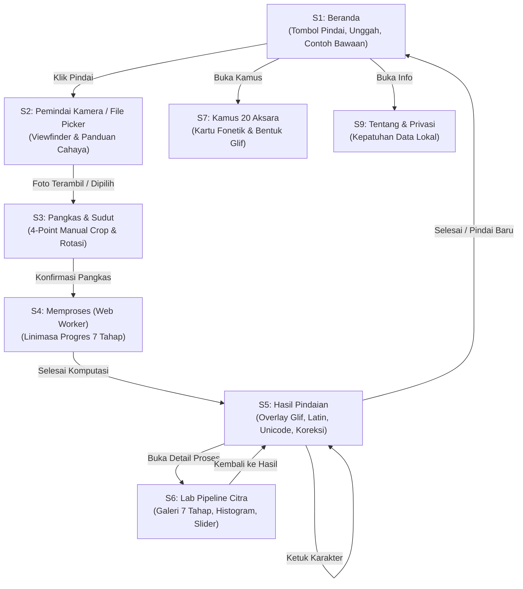

# Product Requirements Document (PRD)
## AksaraScan: Pemindai Aksara Jawa Berbasis Web

| Parameter | Keterangan |
| :--- | :--- |
| **Mata Kuliah** | PTIN236021 Pengolahan Citra dan Komputer Vision (Semester V) |
| **Dosen Pengampu** | Mahfud Jiono, S.Pd., M.Eng. |
| **Kelompok / Tim** | **Kelompok 4** |
| **Penyusun** | 1. Muhammad Rayhan Najib (`240533600012`)<br>2. M. Ikhsan Ridho A. (`240533609185`) |
| **Institusi** | S1 Pendidikan Teknik Informatika, Departemen Teknik Elektro dan Informatika, Universitas Negeri Malang |
| **Versi Dokumen** | 1.0 (Draf Resmi) |
| **Tanggal** | 19 November 2026 |
| **Status Dokumen** | **Keluaran #1: Siap Tinjau** |

---

## 1. Ringkasan Eksekutif & Problem Statement

### 1.1 Latar Belakang & Masalah (*Problem Statement*)
Aksara Jawa (*Hanacaraka*) merupakan warisan budaya literasi nusantara yang sarat nilai historis dan estetika. Namun dalam realitas pendidikan maupun masyarakat umum saat ini:
1. **Kesenjangan Kemampuan Membaca**: Siswa tingkat SMP/SMA dan masyarakat awam kerap mengalami kendala saat membaca tulisan tangan aksara Jawa di buku catatan/lembar kerja karena bentuk karakter yang kompleks dan ketergantungan pada guru atau pakar filologi.
2. **Keterbatasan Alat Bantu Digital**: Perangkat lunak yang beredar di pasaran mayoritas hanya melayani transliterasi satu arah (*Latin ke Aksara Jawa*). Perangkat pemindai dokumen populer (seperti CamScanner, Google Lens, Adobe Scan) dioptimalkan secara eksklusif untuk alfabet Latin atau karakter Han/Kanji, serta hampir selalu bergantung pada koneksi internet (*cloud OCR*).
3. **Kebutuhan Privasi & Aksesibilitas Kelas**: Banyak sekolah menerapkan keterbatasan akses internet di ruang kelas, sehingga dibutuhkan solusi yang dapat berjalan mandiri (*offline-first*), ringan, cepat, dan menjaga privasi pengguna tanpa mengirimkan citra ke server pihak ketiga.
4. **Kebutuhan Akademis Mata Kuliah**: Dalam lingkup akademik mata kuliah Pengolahan Citra Digital, sistem pengenalan karakter tidak boleh diperlakukan sebagai "kotak hitam" (*black-box deep learning*). Diperlukan transparansi matematis penuh pada setiap operasi citra klasik—mulai dari binerisasi, pembersihan derau, filtering, segmentasi spasial, hingga ekstraksi fitur—agar dapat dievaluasi secara ilmiah.

### 1.2 Pernyataan Peluang (*Opportunity Statement*)
Membangun **AksaraScan**: aplikasi web pemindai portabel (*Single Page Application* / PWA) mandiri di sisi klien (*client-only*), yang mampu mendeteksi 20 aksara Jawa dasar (*Nglegena*) dari foto kertas/buku tulis, mengubahnya menjadi transliterasi Latin dan teks Unicode, serta menyajikan visualisasi transparan tahapan pipeline pengolahan citra (*Lab Pipeline*) untuk kebutuhan edukasi dan evaluasi akademik.

---

## 2. Sasaran Produk & Persona

### 2.1 Tujuan Produk (*Product Goals*)
1. **Deteksi Mandiri Berbasis Web**: Memindai foto tulisan tangan 20 aksara Nglegena langsung dari peramban desktop maupun ponsel pintar tanpa dependensi server backend.
2. **Transparansi Edukatif (Lab Pipeline)**: Membuka visualisasi citra antara (*intermediate images*) dan histogram dari setiap tahapan pipeline citra untuk keperluan verifikasi dan penilaian dosen penguji.
3. **Integritas Privasi & Kecepatan**: Menjamin citra pengguna $100\%$ diproses di memori lokal perangkat menggunakan arsitektur *Web Worker* tanpa memblokir thread UI.
4. **Desain Berkarakter Budaya**: Menghadirkan antarmuka bertema "Manuskrip Modern" yang ergonomis, tenang, dan menghormati kaidah budaya Jawa tanpa ornamen berlebihan (*anti-slop UI*).

### 2.2 Batasan Bukan Tujuan (*Non-Goals*)
* **Tidak** melakukan terjemahan makna bahasa Jawa kuno/baru ke bahasa Indonesia (fokus murni pada transliterasi karakter fonetis).
* **Tidak** mengenali aksara di luar 20 Nglegena pada versi MVP (misalnya: *sandhangan*, *pasangan*, *aksara murda*, *swara*, *rekan*, angka Jawa, dan tanda baca di luar cakupan).
* **Tidak** menggunakan model *Deep Learning* berat (seperti CNN, ViT, YOLO, atau cloud OCR API) untuk menjaga kepatuhan kurikulum citra digital klasik berbasis SVM linear.
* **Tidak** menyediakan sistem manajemen pengguna (*user account*), autentikasi, atau basis data komputasi awan.

### 2.3 Persona Pengguna

| Profil Persona | Kebutuhan Utama | Hambatan / Pain Points | Skenario Pemakaian |
| :--- | :--- | :--- | :--- |
| **Nadia (14 Tahun)**<br>*Siswa SMP* | Memeriksa kebenaran tulisan aksara Jawa pada PR buku tulis secara mandiri. | Takut salah; ragu membedakan bentuk aksara yang mirip (*Ra* vs *Ka*, *Pa* vs *Ya*); kuota internet terbatas di rumah. | Membuka AksaraScan di browser ponsel, memotret PR di meja belajar, melihat bacaan Latinnya dalam 3 detik. |
| **Bu Sri (45 Tahun)**<br>*Guru Bahasa Jawa* | Memeriksa puluhan buku tulis siswa dengan cepat dan mendemonstrasikan cara kerja sistem visual di kelas. | Waktu koreksi terbatas; enggan menginstal aplikasi yang rumit dan berat; ponsel kelas *mid-range*. | Mengoreksi tugas di ruang guru atau menghubungkan laptop ke proyektor LCD untuk menampilkan *Lab Pipeline*. |
| **Dimas (21 Tahun)**<br>*Mahasiswa / Pegiat Budaya* | Mengonversi catatan naskah tulisan tangan menjadi teks Aksara Jawa standar Unicode. | Mengetik manual aksara satu per satu lambat; aplikasi komersial tidak mengenali aksara Jawa tulisan tangan. | Memotret catatan kajian budaya, menyalin teks Unicode dan Latin, lalu menempelkannya ke dokumen riset. |
| **Mahfud Jiono, S.Pd., M.Eng.**<br>*Dosen Penguji Mata Kuliah* | Menilai validitas metode, ketepatan rumus pengolahan citra klasik, dan kestabilan parameter teknis. | Banyak proyek mahasiswa menggunakan *black-box API* atau pustaka instan tanpa pemahaman matematis. | Membuka layar *Lab Pipeline* saat ujian tugas akhir, menguji batas ambang (*Otsu threshold*), kernel median, dan *confusion matrix*. |

---

## 3. Cerita Pengguna Prioritas (*User Stories*)

| ID | Sebagai... | Saya Ingin... | Agar... | Kriteria Penerimaan |
| :--- | :--- | :--- | :--- | :--- |
| **US-01** | Siswa / Pengguna | Memotret halaman buku tulis langsung dengan kamera belakang ponsel. | Tidak perlu berpindah aplikasi kamera bawaan atau memindahkan berkas secara manual. | Tampilan kamera responsif dengan *viewfinder guide*, tombol bidik $\ge 48\text{ dp}$, dan deteksi orientasi. |
| **US-02** | Pengguna | Mengunggah berkas foto yang sudah ada dari galeri (JPG, PNG, WebP). | Dapat memproses foto tugas yang diambil sebelumnya dalam pencahayaan yang lebih baik. | *File picker* menerima format standar, membatasi ukuran memori, dan menampilkan pratinjau instan. |
| **US-03** | Pengguna | Memotong (*crop*) dan meluruskan sudut foto secara manual. | Daerah non-tulisan (meja, jari, bayangan tepi) tereliminasi sebelum inferensi. | Tersedia 4 titik kontrol sudut (*corner handles*) dan opsi rotasi $90^\circ$. |
| **US-04** | Pengguna | Melihat hasil transliterasi Latin dan teks aksara Unicode secara langsung di atas foto (*bounding box overlay*). | Dapat memverifikasi posisi aksara mana yang menghasilkan huruf tertentu. | Kotak karakter membungkus glif secara presisi dilengkapi label dan persentase skor keyakinan (*confidence*). |
| **US-05** | Siswa / Guru | Mengetuk kotak aksara yang salah untuk mengoreksi kelasnya secara manual. | Hasil salinan teks akhir tetap $100\%$ valid meskipun model salah memprediksi aksara yang goresannya samar. | Muncul panel bawah (*bottom sheet*) 20 aksara Nglegena dengan 3 kandidat probabilitas tertinggi di baris teratas. |
| **US-06** | Dosen Penguji | Mengakses layar **Lab Pipeline** untuk menginspeksi hasil 7 tahap pemrosesan beserta histogramnya. | Dapat menilai penerapan matematis grayscale, binerisasi, filter morfologi, dan segmentasi proyeksi. | Tersedia galeri visual tahap demi tahap, perbandingan *before-after*, dan slider eksperimen parameter. |
| **US-07** | Pengguna | Menginstal aplikasi ke layar utama (*Add to Home Screen*) dan menggunakannya tanpa sambungan internet. | Tetap dapat digunakan di area sekolah tanpa jaringan Wi-Fi/kuota data seluler. | PWA lulus uji *Lighthouse Offline*, Service Worker meng-cache seluruh aset, font, dan bobot model. |
| **US-08** | Pengguna | Menyalin teks hasil (*copy to clipboard*) dan mengunduh berkas gambar ringkasan (PNG). | Teks dapat langsung dibagikan ke WhatsApp tugas sekolah atau dilampirkan ke dokumen laporan. | Tombol satu ketukan dengan umpan balik visual (*toast notification*) "Teks berhasil disalin". |

---

## 4. Metrik Keberhasilan Produk (*Success Metrics*)

Semua target metrik ditetapkan secara realistis untuk kapasitas tim 2 orang dalam kerangka tugas akhir akademik:

| Parameter Metrik | Target Awal | Metode Pengukuran & Pembuktian |
| :--- | :--- | :--- |
| **Akurasi Model Karakter** | Target $\ge 85\%$ pada *writer-independent test set* | Evaluasi offline Python & evaluasi verifikasi JS terhadap minimal 15–20 penulis berbeda. Laporan menyertakan *Confusion Matrix* transparan bertanda `[ISI SETELAH EVALUASI]`. |
| **Character Error Rate (CER)** | $\le 15\%$ pada kalimat uji buku tulis | $\text{CER} = \frac{\text{Levenshtein}(T_{\text{ground\_truth}}, T_{\text{prediksi}})}{\text{Length}(T_{\text{ground\_truth}})}$ |
| **Latensi Pemrosesan (Latency)** | $\le 3.0\text{ detik}$ (median) pada sisi panjang $1600\text{ px}$ | Diukur pada ponsel Android kelas menengah (mis. chipset MediaTek Helio G99 / Snapdragon 680) via `performance.now()` di Web Worker. |
| **Waktu Blokir Antarmuka (UI Jitter)** | $0\text{ ms}$ jank ($T_{\text{long\_task}} < 50\text{ ms}$) | Seluruh komputasi konvolusi, proyeksi, dan SVM berjalan murni di Web Worker terpisah. Thread UI stabil pada 60 FPS. |
| **Ukuran Bundel Aplikasi (*Bundle Size*)** | $\le 2.5\text{ MB}$ total transfer | JS utama $\le 250\text{ KB}$ (gzip), model SVM JSON $\le 1.0\text{ MB}$, Font Noto Sans Javanese termuat secara *lazy-load*. |
| **Keamanan & Privasi** | $0$ permintaan keluar (*Zero egress traffic*) | Audit devtools jaringan (*Network tab*): tidak ada pelacak pihak ketiga atau unggah citra keluar domain aplikasi. |
| **Evaluasi Kegunaan (*Usability*)** | Rata-rata skor SUS $\ge 68$ (*Acceptable/Good*) | Kuesioner System Usability Scale (SUS) kepada minimal 10 responden (siswa, guru, dan mahasiswa). |

---

## 5. Kebutuhan Fungsional (*Functional Requirements*)

Penyusunan kebutuhan fungsional menerapkan klasifikasi prioritas **MoSCoW**:

```
                    ┌─────────────────────────┐
                    │  Kebutuhan Fungsional   │
                    └────────────┬────────────┘
         ┌───────────────────────┼───────────────────────┐
         ▼                       ▼                       ▼
   [Must Have]             [Should Have]           [Could Have]
 (Inti MVP Web PWA)     (Penyempurnaan MVP-2)   (Fitur Tambahan)
   • FR-01: Kamera         • FR-09: Tuning Param   • FR-18: Riwayat Lokal
   • FR-02: Unggah Galeri  • FR-12: Flag Ragu (?)  • FR-19: Ekspor Gambar
   • FR-03: Crop Sudut     • FR-13: Adaptif Otsu   • FR-20: Auto-warp Tepi
   • FR-04: Worker Core    • FR-14: Kamus Aksara
   • FR-05: Bounding Box   • FR-17: APK Capacitor
   • FR-06: Transliterasi
   • FR-07: Koreksi Ketuk
   • FR-08: Lab Pipeline
   • FR-10: PWA Offline
   • FR-11: Dark/Light
   • FR-15: Bahasa & Sapaan
   • FR-16: Edukasi Privasi
```

### 5.1 Kategori Must Have (MVP-1: Web PWA Inti)
* **FR-01 (Kamera Terintegrasi)**: Mengakses `navigator.mediaDevices.getUserMedia` dengan kontrol kamera belakang (*environment facing*), *guide overlay* orientasi kertas, dan indikator peringatan kondisi gelap.
* **FR-02 (Unggah Berkas)**: Menerima berkas JPG, PNG, dan WebP hingga ukuran 15 MB dengan kompresi otomatis di sisi klien ke resolusi kerja (maksimum panjang $1600\text{ px}$).
* **FR-03 (Pangkas Interaktif)**: Menyediakan editor pangkas dengan 4 pin sudut kontrol drag-and-drop untuk memotong area tulisan dan rotasi langkah $90^\circ$.
* **FR-04 (Eksekusi Web Worker)**: Menjalankan seluruh pipeline citra pada thread latar belakang, dilengkapi status tahapan aktual (misal: *"Menghitung Ambang Otsu..."*, *"Morfologi Citra..."*, *"Klasifikasi Karakter..."*).
* **FR-05 (Visualisasi Deteksi Kotak)**: Menampilkan *bounding box* tipis ($1.5\text{ px}$) di atas kanvas citra dengan penandaan warna status keyakinan (emas prada untuk yakin, aksen khusus untuk ragu).
* **FR-06 (Dua Format Luaran Teks)**: Mengeluarkan transliterasi Latin fonetik (misal: "ha na ca ra ka") dan rangkaian karakter Aksara Jawa Unicode (`ꦲ ꦤ ꦕ ꦫ ꦏ`).
* **FR-07 (Koreksi Cepat Karakter)**: Ketuk pada glif membuka *bottom sheet* berisi 20 aksara Nglegena; memilih aksara pengganti seketika memperbarui teks Latin dan Unicode.
* **FR-08 (Lab Pipeline 7 Tahap)**: Panel edukasi yang menampilkan galeri citra antara dari setiap tahapan pipeline:
  1. Citra Asli (Terskala)
  2. Grayscale (Luminansi $0.299R + 0.587G + 0.114B$)
  3. Binerisasi Otsu (Pemisahan latar belakang otomatis)
  4. Median Filter ($3 \times 3$ untuk menghilangkan salt-and-pepper noise)
  5. Morfologi Citra (Penghapusan garis buku, *Closing* untuk menyambung goresan, *Opening* untuk isolasi glif)
  6. Segmentasi Proyeksi (Profil proyeksi horizontal baris & vertikal karakter)
  7. Glif Ternormalisasi ($96 \times 96$ piksel terpusat)
* **FR-10 (Dukungan Offline PWA)**: PWA dapat diinstal di homescreen Android/iOS dan tetap berfungsi penuh saat perangkat dalam *Airplane Mode*.
* **FR-11 (Dua Tema Manuskrip)**: Mendukung Mode Gelap (*Wulung Keraton*) sebagai default hemat daya/nyaman di mata dan Mode Terang (*Kertas Dluwang*).
* **FR-15 (Antarmuka Bersahabat)**: Menggunakan Bahasa Indonesia formal akademis dengan sapaan/istilah aksara Jawa yang ramah dan kontekstual.
* **FR-16 (Jaminan Privasi Transparan)**: Halaman informasi yang secara eksplisit menegaskan bahwa tidak ada data atau foto yang dikirim ke jaringan luar.

### 5.2 Kategori Should Have (MVP-2: Pemasangan & Keandalan Lapangan)
* **FR-09 (Slider Parameter Lab)**: Pengguna dapat bereksperimen mengubah ukuran kernel median ($3\times3, 5\times5$), kernel struktur morfologi, dan ambang batas lembah (*valley threshold*).
* **FR-12 (Penandaan Glif Ragu)**: Karakter dengan margin fungsi keputusan (*decision function*) di bawah ambang toleransi diberi label tanda tanya (`?`), mencegah tebakan salah yang membingungkan siswa.
* **FR-13 (Binerisasi Adaptif Fallback)**: Secara cerdas mengaktifkan binerisasi adaptif (*local thresholding*) jika binerisasi Otsu global mendeteksi standar deviasi histogram pencahayaan yang terlalu timpang (misal ada bayangan tangan).
* **FR-14 (Kamus 20 Aksara Nglegena)**: Halaman referensi kartu aksara yang memuat bentuk glif, nama fonetik, bunyi pengucapan, dan urutan filosofi Hanacaraka.
* **FR-17 (Pembungkus APK Android via Capacitor)**: Menghasilkan berkas APK debug dari basis kode web yang sama menggunakan plugin `@capacitor/camera` untuk efisiensi perangkat keras.

### 5.3 Kategori Could Have & Won't Have
* **Could Have (FR-18 s/d FR-20)**: Riwayat pindaian lokal berbasis IndexedDB, unduh ringkasan hasil dalam format gambar PNG komposit, dan auto-deteksi kontur tepi dokumen (koreksi perspektif otomatis).
* **Won't Have (Di Luar Cakupan)**: Autentikasi akun, penyimpanan awan, pengenalan sandhangan/pasangan, koreksi tata bahasa kalimat (*language model*), dan model *Deep Learning* berbobot besar.

---

## 6. Kebutuhan Non-Fungsional (*Non-Functional Requirements*)

### 6.1 Kinerja Komputasi & Responsivitas
* Komputasi matriks piksel harus dioptimalkan menggunakan typed array standar browser (`Uint8ClampedArray`, `Uint8Array`, `Float32Array`).
* Tidak diperkenankan melakukan mutasi DOM berulang pada loop komputasi citra.
* Animasi perpindahan status dan transisi UI dibatasi pada rentang $150\text{–}250\text{ ms}$ dengan kurva perlambatan `cubic-bezier(.2, .7, .2, 1)`.

### 6.2 Aksesibilitas & Kompatibilitas Perangkat
* **Standar Aksesibilitas**: Memenuhi WCAG 2.2 Level AA dengan rasio kontras teks minimum $4.5:1$ pada teks normal dan $3:1$ pada teks besar/komponen UI.
* **Area Sentuh Minimum**: Semua tombol, tab, dan area seleksi karakter memiliki dimensi sentuh minimal $48 \times 48\text{ dp}$ (atau $44\text{ px}$ pada CSS).
* **Target Browser**:
  - Google Chrome / Brave / Edge (Android & Desktop) v110+
  - Safari & Chrome iOS (iOS 15.0+)
  - Mozilla Firefox v115+ (ESR & Modern)
* **Dukungan Layar**: Tata letak fleksibel mulai dari lebar layar $360\text{ px}$ (ponsel kompak) hingga $1440\text{ px}$ (laptop/proyektor kelas).

---

## 7. Arsitektur Layar & Alur Navigasi Pengguna



---

## 8. Ringkasan Keterlacakan ke Materi Kuliah (Silabus PTIN236021)

Dokumen PRD ini secara langsung menjamin keterkaitan materi akademik yang diajarkan oleh Dosen Pengampu:

| Tahapan di AksaraScan | Materi Perkuliahan (Gonzalez & Woods) | Bentuk Pembuktian di Aplikasi |
| :--- | :--- | :--- |
| **Grayscale & Resampling** | Bab 2: *Digital Image Fundamentals* | Matriks intensitas $f(x,y)$, reduksi dimensi resolusi. |
| **Koreksi Kontras & Binerisasi** | Bab 3: *Intensity Transformations* & Bab 10: *Thresholding* | Transformasi ambang batas Otsu (*between-class variance*), penanganan histogram bimodal. |
| **Pembersihan Derau Kertas** | Bab 3: *Spatial Filtering (Non-linear Order-Statistic)* | Penerapan filter median $3\times3$ untuk meredam noise bintik tanpa mengaburkan tepi tulisan. |
| **Penghilangan Garis & Glif** | Bab 9: *Morphological Image Processing* | Erosi garis horizontal, operasi *Closing* (menutup celah tinta pulpen), dan *Opening* (memisahkan artefak terluar). |
| **Pemisahan Baris & Huruf** | Bab 10 & 11: *Segmentation & Representation* | Proyeksi integral horizontal/vertikal $\sum f(x,y)$, *connected components labeling*. |
| **Normalisasi Glif** | Bab 11: *Representation and Description* | Skala isotropik, penambahan margin kanvas $96 \times 96$ piksel. |
| **Klasifikasi Karakter** | Materi Penunjang: *Pattern Classification / Machine Learning* | Model SVM linear (*One-vs-Rest* hyperplane decision boundary). |

---

> [!NOTE]
> **Status Kelulusan Tahap 1**: PRD ini telah memetakan kebutuhan akademik Kelompok 4, peran pengguna, batasan teknis, dan rancangan fitur secara utuh. Siap dilanjutkan ke **Keluaran #2: Dokumen Batasan dan Asumsi** setelah konfirmasi.
