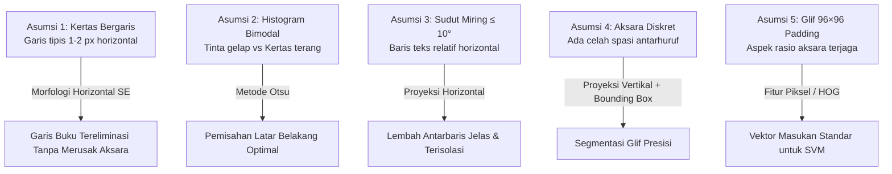

# Dokumen Batasan dan Asumsi (Scope Constraints & Assumptions)
## AksaraScan: Pemindai Aksara Jawa Berbasis Web

| Parameter | Keterangan |
| :--- | :--- |
| **Mata Kuliah** | PTIN236021 Pengolahan Citra dan Komputer Vision (Semester V) |
| **Dosen Pengampu** | Mahfud Jiono, S.Pd., M.Eng. |
| **Kelompok / Tim** | **Kelompok 4** |
| **Penyusun** | 1. Muhammad Rayhan Najib (`240533600012`)<br>2. M. Ikhsan Ridho A. (`240533609185`) |
| **Institusi** | S1 Pendidikan Teknik Informatika, Departemen Teknik Elektro dan Informatika, Universitas Negeri Malang |
| **Versi Dokumen** | 1.0 (Draf Resmi) |
| **Tanggal** | 19 November 2026 |
| **Status Dokumen** | **Keluaran #2: Siap Tinjau** |

---

## 1. Pendahuluan & Tujuan Dokumen

Dokumen ini mendefinisikan batas ruang lingkup (*scope boundaries*), spesifikasi toleransi masukan citra, batasan arsitektur perangkat lunak, serta asumsi-asumsi ilmiah yang mendasari perancangan sistem **AksaraScan**.

Dokumen ini berfungsi sebagai:
1. **Panduan Rekayasa (*Engineering Contract*)**: Menjaga fokus pengembangan tim agar tidak mengalami *scope creep* dalam durasi sprint 4 minggu.
2. **Keterbatasan Penelitian Ilmiah**: Bagian resmi yang akan dituangkan pada **Bab I (Batasan Masalah)** dan **Bab V (Saran & Pengembangan Lanjutan)** dalam Laporan Tugas Akhir.
3. **Argumen Pembelaan Akademik (*Academic Defense*)**: Landasan rasional bagi penyusun saat mempertahankan metodologi di hadapan Dosen Pengampu (Bapak Mahfud Jiono, S.Pd., M.Eng.).

---

## 2. Batasan Ruang Lingkup (*Scope Constraints*)

Pemisahan tegas antara area yang ditangani oleh sistem (*in-scope*) dan area yang secara eksplisit dikecualikan (*out-of-scope*):

```
┌────────────────────────────────────────────────────────────────────────┐
│                      RUANG LINGKUP AKSRASCAN                           │
├───────────────────────────────────┬────────────────────────────────────┤
│         DI DALAM CAKUPAN          │          DI LUAR CAKUPAN           │
│             (In-Scope)            │           (Out-of-Scope)           │
├───────────────────────────────────┼────────────────────────────────────┤
│ • 20 Aksara Nglegena              │ • Sandhangan (swara, panyigeg, dll)│
│ • Tulisan tangan diskret          │ • Pasangan & Aksara Murda/Swara    │
│ • Tinta gelap di kertas terang    │ • Tulisan sambung (cursive)        │
│ • Satu halaman per pindaian       │ • Multi-halaman / Naskah lontar lapuk│
│ • Inferensi 100% di browser (PWA) │ • Backend, database cloud, akun    │
│ • Segmentasi spasial klasik       │ • Model Deep Learning (CNN/YOLO)   │
│ • Pipeline scratch di TypeScript  │ • OpenCV.js di production bundle   │
└───────────────────────────────────┴────────────────────────────────────┘
```

### 2.1 Di Dalam Cakupan (*In-Scope*)
1. **20 Aksara Dasar (*Nglegena*)**: Pengenalan terbatas pada 20 karakter konsonan dasar bahasa Jawa tanpa modifikasi bunyi:
   $$\{\text{Ha}, \text{Na}, \text{Ca}, \text{Ra}, \text{Ka}, \text{Da}, \text{Ta}, \text{Sa}, \text{Wa}, \text{La}, \text{Pa}, \text{Dha}, \text{Ja}, \text{Ya}, \text{Nya}, \text{Ma}, \text{Ga}, \text{Ba}, \text{Tha}, \text{Nga}\}$$
2. **Media Tulisan Tangan Kertas**: Tulisan tangan menggunakan pena bertinta hitam atau biru tua pada media kertas polos atau buku tulis bergaris standar siswa.
3. **Pemisahan Karakter Diskret**: Aksara ditulis terpisah secara wajar dengan adanya spasi/celah antarkarakter (*discrete handwriting*).
4. **Pemrosesan Citra Sisi Klien Penuh**: Seluruh siklus eksekusi (mulai dari pemuatan citra, konversi luminansi, ambang batas, filtering morfologi, pemotongan segmen, hingga inferensi klasifikasi) dieksekusi di browser pengguna via *Web Worker*.
5. **Dukungan Dua Form Factor**: Antarmuka responsif untuk ponsel pintar (layar potret $\ge 360\text{ px}$) dan desktop/laptop (layar lanskap $\ge 1024\text{ px}$).

### 2.2 Di Luar Cakupan (*Out-of-Scope / Keterbatasan Ilmiah*)
Hal-hal berikut sengaja dikecualikan dan wajib dicantumkan dalam laporan tugas akhir sebagai batasan masalah:
1. **Sistem Diakritik (*Sandhangan*)**: Tidak mengenali sandhangan swara (*wulu, suku, taling, taling tarung, pepet*), sandhangan panyigeging wanda (*wigyan, layar, ceceg, pangkon*), maupun sandhangan wyanjana (*cakra, keret, pengkal*).
2. **Pasangan dan Variasi Aksara Lanjutan**: Tidak mendeteksi aksara *pasangan*, aksara *murda* (huruf kapital kehormatan), aksara *swara* (vokal mandiri), aksara *rekan* (bunyi serapan asing), angka Jawa, maupun tanda baca khusus (*pada lingsa, pada lungsi, pada pangkat*).
3. **Aksara Sambung / Bersentuhan (*Touching Characters*)**: Tidak menangani karakter yang goresan tintanya saling menempel secara fisik antaraksara atau tumpang tindih antardua baris tulisan.
4. **Koreksi Bahasa Kontekstual (*Language Model / NLP*)**: Hasil transliterasi disajikan murni secara fonetis per karakter hasil prediksi model, tanpa mesin pemeriksa tata bahasa atau kamus leksikal bahasa Jawa.
5. **Kondisi Media Ekstrem**: Naskah daun lontar kuno yang lapuk, prasasti batu/tembaga, kertas bermotif ornamen latar belakang yang pekat, atau tulisan kapur di papan tulis.
6. **Infrastruktur Komputasi Awan**: Tidak menyediakan sinkronisasi akun pengguna, basis data terpusat, analitik pelacakan pengguna, atau REST API backend.
7. **Model Deep Learning**: Tidak mengimplementasikan arsitektur Convolutional Neural Network (CNN), Vision Transformer, atau detektor YOLO pada modul produksi utama.

---

## 3. Spesifikasi & Batasan Masukan Citra (*Input Constraints*)

Sistem menetapkan toleransi parameter masukan foto agar menghasilkan luaran binerisasi dan segmentasi yang stabil:

| Parameter Citra | Batasan / Nilai Toleransi | Dampak / Penanganan Jika Melebihi Batas |
| :--- | :--- | :--- |
| **Dimensi Resolusi** | Sisi panjang $\ge 1280\text{ px}$, diresample ke maks $1600\text{ px}$ | Citra $< 1280\text{ px}$ memicu peringatan kualitas; citra $> 1600\text{ px}$ diperkecil otomatis demi menghemat memori Web Worker. |
| **Tinggi Karakter Minimum** | Tinggi aksara $\ge 25\text{ px}$ pada citra kerja | Karakter yang terlalu kecil ($< 15\text{ px}$) rentan hilang tererosi oleh kernel filter morfologi. |
| **Kemiringan Baris (*Skew Angle*)** | Maksimal $\pm 10^\circ$ dari sumbu horizontal | Kemiringan $> 10^\circ$ menyebabkan puncak proyeksi integral horizontal tumpang tindih; pengguna diarahkan memutar citra pada modul pangkas. |
| **Keseragaman Cahaya** | Rasio pencahayaan sudut terhadap pusat $\ge 0.5$ | Gradien gelap-terang ekstrem memicu *fallback* ke binerisasi adaptif lokal atau peringatan "Pencahayaan Tidak Rata". |
| **Kontras Tinta & Kertas** | Tinta gelap (RGB rata-rata $\le 90$) di kertas terang (RGB $\ge 170$) | Pensil tipis atau tinta warna pudar menghasilkan glif terputus setelah binerisasi. |
| **Format Berkas** | JPEG, PNG, WebP (maksimal $15\text{ MB}$) | Format berkas di luar daftar ditolak pada tingkat *file picker*. |

---

## 4. Batasan Teknis & Arsitektur Perangkat Lunak

### 4.1 Pemrosesan Mandiri di Sisi Klien (*Client-Side Only*)
* Seluruh operasi citra dieksekusi di lingkungan runtime JavaScript/TypeScript browser. Citra tidak pernah diunggah ke internet (*zero network transmission*).
* Hosting web bersifat statis murni (*JAMstack*) melalui protokol wajib HTTPS agar API kamera peramban (`navigator.mediaDevices`) dapat diakses.

### 4.2 Larangan Pustaka Berat di Lingkungan Produksi
* **Operasi Citra Murni (*Scratch Implementation*)**: Modul konversi grayscale, thresholding Otsu, filter median, operasi morfologi (*erosion, dilation, opening, closing*), proyeksi integral, dan resampling ditulis sendiri dalam TypeScript memanfaatkan struktur data `Uint8ClampedArray` dan `Float32Array`.
* **Peran OpenCV.js**: OpenCV.js **dilarang keras** dimasukkan ke dalam bundel produksi aplikasi (*production build*) guna menjaga ukuran bundel tetap di bawah $3\text{ MB}$. OpenCV.js hanya diizinkan sebagai modul pembanding (*golden benchmark*) pada berkas uji otomatis (*unit test*).

### 4.3 Algoritma Pengklasifikasi SVM Linear
* Model klasifikasi berupa **Support Vector Machine (SVM) Linear** dengan skema multi-kelas *One-vs-Rest* (OvR) untuk 20 kelas.
* Pelatihan dilakukan secara terpisah (*offline*) menggunakan Python (`scikit-learn`), kemudian matriks bobot ($W \in \mathbb{R}^{20 \times D}$) dan bias ($b \in \mathbb{R}^{20}$) diekspor ke berkas JSON berukuran ringkas ($\le 1\text{ MB}$).
* Inferensi di browser dihitung melalui perkalian dot matriks murni:
  $$\hat{y} = \arg\max_{c \in \{1,\dots,20\}} \left( \mathbf{w}_c^T \mathbf{x} + b_c \right)$$

### 4.4 Target Runtime & Perangkat
* Peramban mobile: Google Chrome Android v100+, Safari iOS v15.4+, Samsung Internet v18+.
* Peramban desktop: Chromium engine (Chrome, Edge, Brave, Opera) dan Mozilla Firefox ESR/Modern.
* Memori kerja: Konsumsi heap memori selama pemrosesan citra tidak boleh melampaui $150\text{ MB}$ pada ponsel dengan RAM fisik 3–4 GB.

---

## 5. Batasan Sumber Daya Proyek (*Project Constraints*)

1. **Komposisi Tim**: Dikerjakan secara kolaboratif oleh 2 mahasiswa:
   - **Muhammad Rayhan Najib (`240533600012`)**: Koordinator teknis, perancang arsitektur pipeline citra, ekstraksi fitur, dan model klasifikasi.
   - **M. Ikhsan Ridho A. (`240533609185`)**: Pengembang frontend UI/UX, pengumpul & kurator dataset tulisan tangan, serta pengujian sistem.
2. **Durasi Pengerjaan**: Sprint terstruktur selama **4 minggu kalender** (menuju jadwal presentasi Proyek Akhir Pekan ke-16 Semester V).
3. **Biaya Finansial**: Alokasi dana Rp 0 (memanfaatkan ekosistem perangkat lunak sumber terbuka dan hosting statis tanpa biaya).
4. **Dataset Mandiri**:
   - Sumber: Lembar penulisan aksara tangan yang dikumpulkan dari minimal 15–20 mahasiswa/siswa unik.
   - Volume: Target minimum $\ge 60$ sampel valid per kelas aksara Nglegena (total $\ge 1.200$ sampel karakter berlabel).

---

## 6. Asumsi-Asumsi Ilmiah Sistem (*Technical Assumptions*)

Setiap keputusan rekayasa dalam pipeline didasarkan pada asumsi ilmiah yang teruji:



* **Asumsi 1 (Model Bimodal Intensitas)**: Citra dokumen tulisan tangan memiliki histogram intensitas bimodal (distribusi piksel teks bertumpuk di intensitas rendah dan piksel kertas di intensitas tinggi), sehingga kriteria maksimasi variansi antarkelas (*between-class variance*) pada algoritma Otsu valid digunakan.
* **Asumsi 2 (Struktur Garis Buku Tulis)**: Garis bantu pada buku tulis siswa memiliki karakteristik geometris berupa kontur horizontal tipis kontinu ($1\text{–}2\text{ px}$). Dengan elemen penstruktur (*structuring element*) horizontal yang tepat, garis dapat dihilangkan secara morfologis tanpa memotong batang vertikal aksara Jawa.
* **Asumsi 3 (Linearitas Baris Teks)**: Tulisan tangan di buku tulis berbaris memiliki kemiringan rata-rata $\le 10^\circ$. Profil proyeksi integral horizontal $\sum_{x} I(x,y)$ akan menghasilkan lembah (*valleys*) yang tegas bernilai nol atau mendekati nol di antara baris-baris kalimat.
* **Asumsi 4 (Independensi Glif Diskret)**: Siswa menuliskan aksara dasar secara terpisah (bukan huruf sambung steno). Profil proyeksi integral vertikal per baris dapat membedakan batas awal dan batas akhir masing-masing karakter.
* **Asumsi 5 (Preservasi Proporsi Bentuk Glif)**: Karakter aksara Jawa memiliki signifikansi ciri pada rasio tinggi terhadap lebarnya. Oleh karena itu, normalisasi kanvas ke $96 \times 96\text{ px}$ wajib mempertahankan *aspect ratio* asli menggunakan padding latar belakang putih, bukan peregangan (*stretching*) non-linier.
* **Asumsi 6 (Keterpisahan Linier Ruang Fitur)**: Karakter aksara Jawa yang telah dinormalisasi ke ukuran $96 \times 96\text{ px}$ dan diekstraksi ke vektor fitur berdimensi tetap memiliki batas keputusan yang cukup terpisah (*linearly separable*) di ruang berdimensi tinggi menggunakan SVM linear.

---

## 7. Landasan Pembelaan Akademik di Hadapan Dosen (*Defense Justification*)

Saat sidang evaluasi bersama Bapak Mahfud Jiono, S.Pd., M.Eng., pertimbangan metodologis berikut dapat dipertanggungjawabkan secara ilmiah:

### 7.1 Mengapa Memilih SVM Linear, Bukan Convolutional Neural Network (CNN)?
1. **Kepatuhan Terhadap Silabus PTIN236021**: Fokus mata kuliah adalah penguasaan konsep ruang spasial, transformasi intensitas, filtering, morfologi, segmentasi, dan representasi fitur (Gonzalez & Woods Bab 2, 3, 9, 10, 11). SVM menuntut rekayasa fitur (*feature engineering*) yang eksplisit dan transparan, sementara CNN berperan sebagai *black-box feature learner*.
2. **Keterbatasan Ukuran Dataset**: Arsitektur CNN rentan mengalami *overfitting* fatal jika dilatih pada dataset kecil ($\approx 1.200$ sampel). Sebaliknya, SVM linear terbukti memiliki *generalization bound* yang kokoh pada rasio sampel-terhadap-fitur berdimensi menengah.
3. **Efisiensi Lingkungan Browser**: Model SVM linear dalam format JSON hanya berukuran $\approx 700\text{ KB}$ dengan waktu inferensi $< 5\text{ ms}$ per karakter di JavaScript, tanpa memerlukan runtime besar seperti TensorFlow.js atau ONNX Web Runtime (yang menambah ukuran bundel sebesar $15\text{–}30\text{ MB}$).

### 7.2 Mengapa Menulis Pipeline Mandiri di TypeScript, Bukan Menggunakan OpenCV.js?
1. **Nilai Edukatif & Integritas Tugas Akhir**: Menulis algoritma Otsu, konvolusi median, erosi, dilasi, dan proyeksi histogram secara manual membuktikan pemahaman mendalam mahasiswa terhadap struktur matriks piksel dan rumus matematika yang diajarkan di kelas.
2. **Kebutuhan Fitur Lab Pipeline**: Untuk menampilkan citra antara pada 7 tahapan proses secara interaktif, pustaka eksternal sering kali menyembunyikan langkah perantara. Kode mandiri memungkinkan inspeksi variabel matriks pada setiap baris logika.
3. **Optimasi Ukuran Bundel Web**: Pustaka OpenCV.js yang dikompilasi ke WebAssembly memiliki bobot berkas $\ge 8\text{ MB}$, yang sangat lambat dimuat pada jaringan seluler sekolah. Kode mandiri TypeScript AksaraScan hanya berbobot total $\approx 180\text{ KB}$ setelah minifikasi.

---

> [!NOTE]
> **Status Kelulusan Tahap 2**: Dokumen Batasan dan Asumsi telah siap. Siap dilanjutkan ke **Keluaran #3: Spesifikasi Teknis dan Arsitektur** setelah konfirmasi dari Anda.
