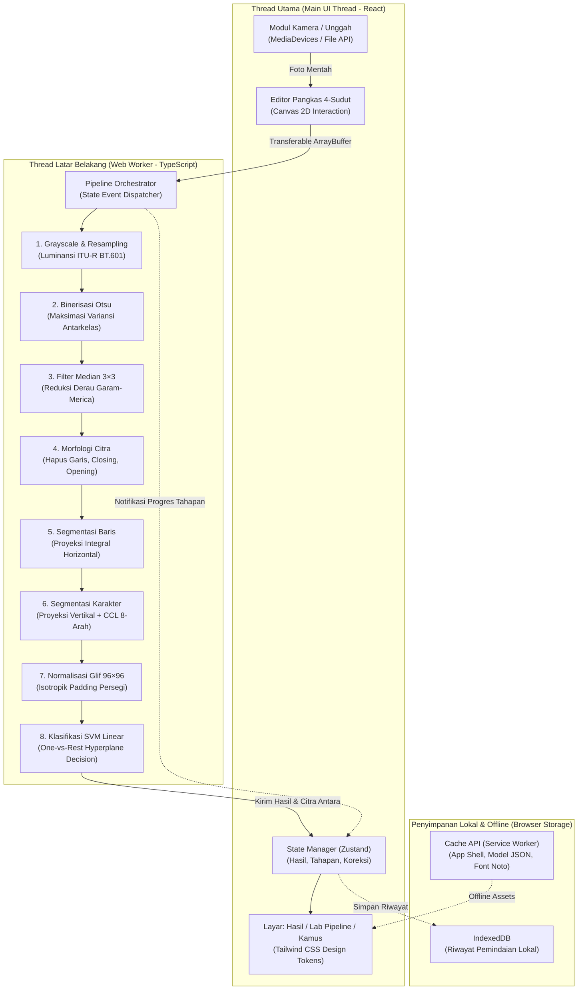
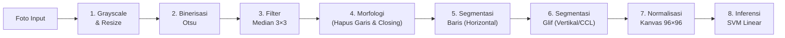

# Spesifikasi Teknis dan Arsitektur Sistem
## AksaraScan: Pemindai Aksara Jawa Berbasis Web

| Parameter | Keterangan |
| :--- | :--- |
| **Mata Kuliah** | PTIN236021 Pengolahan Citra dan Komputer Vision (Semester V) |
| **Dosen Pengampu** | Mahfud Jiono, S.Pd., M.Eng. |
| **Kelompok / Tim** | **Kelompok 4** |
| **Penyusun** | 1. Muhammad Rayhan Najib (`240533600012`)<br>2. M. Ikhsan Ridho A. (`240533609185`) |
| **Institusi** | S1 Pendidikan Teknik Informatika, Departemen Teknik Elektro dan Informatika, Universitas Negeri Malang |
| **Versi Dokumen** | 1.0 (Draf Resmi) |
| **Tanggal** | 19 November 2026 |
| **Status Dokumen** | **Keluaran #3: Siap Tinjau** |

---

## 1. Arsitektur Tingkat Tinggi (*High-Level Architecture*)

AksaraScan dibangun menggunakan pendekatan **Client-Only Single Page Application (SPA)** dengan prinsip pemisahan thread (*off-main-thread computation*). Semua komputasi matriks citra dan inferensi klasifikasi dieksekusi di dalam **Web Worker**, sehingga thread utama (*Main UI Thread*) tetap bebas dari beban komputasi berat dan menjamin tampilan antarmuka berjalan mulus pada 60 FPS tanpa jeda (*zero UI freeze*).



---

## 2. Tumpukan Teknologi (*Technology Stack*)

| Lapisan Sistem | Teknologi / Pustaka | Versi Target | Alasan Pemilihan & Nilai Teknis |
| :--- | :--- | :--- | :--- |
| **Runtime & Bundler** | Vite + TypeScript | Vite 5.x / TS 5.x | *Fast build*, ekosistem modern, *strict typing* untuk manipulasi memori biner matriks. |
| **Kerangka Kerja UI** | React | React 18.x | Komponen deklaratif, stabilitas rendering kanvas, ekosistem UI matang. |
| **Manajemen Status** | Zustand | Zustand 4.x | *Micro-state manager* ringan ($< 1\text{ KB}$), reaktif di luar komponen React, mudah diintegrasikan dengan Web Worker. |
| **Gaya & Token Desain** | Tailwind CSS | Tailwind 3.4+ | Sistem token utilitas presisi, integrasi token budaya *Manuskrip Modern*, tanpa overhead runtime CSS-in-JS. |
| **Ikonografi & Font** | Lucide React + Noto Sans Javanese | Lucide 0.3x / Google Fonts | Ikon konsisten *stroke* $1.5\text{ px}$ (anti-emoji); glif aksara Jawa standar Unicode resmi. |
| **Komputasi Latar** | Web Worker API (Native) | Native Browser API | Komputasi mandiri tanpa dependensi eksternal, isolasi thread matriks piksel. |
| **PWA & Offline** | `vite-plugin-pwa` (Workbox) | Workbox 7.x | Dukungan instalasi *Add to Home Screen*, Service Worker cache otomatis untuk seluruh aset statis. |
| **Pembungkus Android** | Capacitor CLI | Capacitor 5.x / 6.x | Satu basis kode web dibungkus menjadi APK Android asli dengan jembatan kamera perangkat keras. |
| **Pengujian Unit** | Vitest | Vitest 1.x | Eksekusi tes unit matematika matriks secepat kilat menggunakan *golden images*. |

---

## 3. Struktur Direktori Proyek (*Directory Structure*)

Struktur proyek dirancang bersih, terisolasi per modul fungsional, dan mengikuti konvensi rekayasa perangkat lunak modern:

```
aksarascan/
├── android/                        # Proyek native Android (Capacitor wrapper)
├── public/
│   ├── favicon.ico
│   ├── icon-192.png
│   ├── icon-512.png
│   └── manifest.webmanifest        # Konfigurasi PWA Web App
├── src/
│   ├── assets/                     # Motif ornamen SVG (pada lingsa, kawung halus)
│   ├── model/
│   │   ├── svm_nglegena.json       # Bobot matriks W dan bias b hasil latih Python
│   │   └── labels.json             # Pemetaan indeks 0..19 ke Latin dan Unicode
│   ├── pipeline/                   # OPERASI CITRA MURNI (Pure TS Functions)
│   │   ├── grayscale.ts            # Konversi luminansi matriks
│   │   ├── otsu.ts                 # Algoritma ambang batas global & adaptif
│   │   ├── median.ts               # Filter non-linear median 3x3
│   │   ├── morphology.ts           # Erosi, dilasi, opening, closing, hapus garis
│   │   ├── projection.ts           # Proyeksi integral horizontal & vertikal
│   │   ├── ccl.ts                  # Connected Components Labeling 8-konektivitas
│   │   ├── normalize.ts            # Crop, skala isotropik, kanvas 96x96
│   │   ├── features.ts             # Vektorisasi fitur (downsample / density / HOG)
│   │   └── svm.ts                  # Dot-product inferensi & normalisasi skor
│   ├── workers/
│   │   ├── pipeline.worker.ts      # Web Worker runner & message handler
│   │   └── worker-types.ts         # Definisi tipe pesan I/O worker
│   ├── store/
│   │   ├── useScanStore.ts         # Zustand: citra aktif, bounding box, hasil teks
│   │   └── useSettingsStore.ts     # Zustand: parameter kernel, tema (dark/light)
│   ├── ui/
│   │   ├── components/
│   │   │   ├── Button.tsx          # Tombol bertoken dengan state lengkap
│   │   │   ├── Card.tsx            # Bingkai kartu manuskrip dluwang
│   │   │   ├── BoundingBoxOverlay.tsx # Render kanvas kotak glif di atas foto
│   │   │   ├── CorrectionSheet.tsx # Bottom sheet koreksi manual 20 aksara
│   │   │   └── StageProgress.tsx   # Indikator linimasa progres tahapan
│   │   ├── screens/
│   │   │   ├── HomeScreen.tsx      # S1: Beranda utama
│   │   │   ├── ScanScreen.tsx      # S2: Kamera & input berkas
│   │   │   ├── CropScreen.tsx      # S3: Editor pangkas 4 sudut
│   │   │   ├── ResultScreen.tsx    # S5: Hasil teks, overlay, dan aksi salin
│   │   │   ├── LabPipelineScreen.tsx # S6: Galeri 7 tahap & slider parameter
│   │   │   ├── DictionaryScreen.tsx # S7: Kamus 20 aksara Nglegena
│   │   │   └── AboutScreen.tsx     # S9: Info privasi & akademis
│   │   └── tokens/
│   │       └── colors.ts           # Konstanta warna (sogan, prada, dluwang, dll)
│   ├── App.tsx                     # Router / Screen switcher utama
│   └── main.tsx                    # Titik masuk React DOM
├── tests/
│   ├── fixtures/                   # 10 citra golden uji sintetis & nyata
│   ├── pipeline.test.ts            # Uji unit modul matematika citra
│   └── svm.test.ts                 # Uji validitas inferensi terhadap ground truth
├── capacitor.config.ts             # Konfigurasi pembungkus Android Capacitor
├── package.json
├── tailwind.config.js              # Definisi token warna Manuskrip Modern
├── tsconfig.json
└── vite.config.ts
```

---

## 4. Rincian Teknis & Formulasi Matematis Pipeline Citra

Pipeline pengolahan citra pada AksaraScan dieksekusi secara deterministik dalam 8 tahapan berurutan:



### Tahap 1: Grayscale & Resampling Adaptif
1. **Pengecilan Resolusi Citra (*Resampling*)**: Jika dimensi sisi panjang citra masukan $L_{\max} = \max(W, H) > 1600\text{ px}$, citra diskalakan dengan rasio:
   $$s = \frac{1600}{L_{\max}}, \quad W' = \lfloor W \cdot s \rfloor, \quad H' = \lfloor H \cdot s \rfloor$$
2. **Konversi Ruang Warna ke Intensitas Keabuan (*Grayscale*)**: Menggunakan rumus persepsi luminansi baku ITU-R BT.601 untuk tiap piksel koordinat $(x,y)$:
   $$I(x,y) = \operatorname{round}\left( 0.299 \cdot R(x,y) + 0.587 \cdot G(x,y) + 0.114 \cdot B(x,y) \right)$$
   Data disimpan dalam struktur data typed array `Uint8Array` berukuran $W' \times H'$.

---

### Tahap 2: Binerisasi Ambang Batas Otsu (*Otsu Thresholding*)
Algoritma Otsu mencari nilai ambang batas global $T^* \in [0, 255]$ yang memaksimalkan variansi antarkelas (*between-class variance*) $\sigma_B^2(T)$:
1. Hitung histogram ternormalisasi $p_i = \frac{n_i}{N}$ untuk $i = 0, \dots, 255$.
2. Untuk setiap kemungkinan ambang $T$:
   - Probabilitas kumulatif kelas latar depan dan latar belakang:
     $$\omega_0(T) = \sum_{i=0}^{T} p_i, \quad \omega_1(T) = \sum_{i=T+1}^{255} p_i = 1 - \omega_0(T)$$
   - Nilai rata-rata intensitas kumulatif:
     $$\mu_0(T) = \frac{\sum_{i=0}^{T} i \cdot p_i}{\omega_0(T)}, \quad \mu_1(T) = \frac{\sum_{i=T+1}^{255} i \cdot p_i}{\omega_1(T)}$$
   - Variansi antarkelas:
     $$\sigma_B^2(T) = \omega_0(T) \cdot \omega_1(T) \cdot \left[ \mu_0(T) - \mu_1(T) \right]^2$$
3. Tentukan ambang optimal $T^* = \arg\max_{0 \le T < 255} \sigma_B^2(T)$.
4. Binerisasi citra ke representasi Boolean/Biner:
   $$B(x,y) = \begin{cases} 1 & \text{jika } I(x,y) \le T^* \quad (\text{tinta / teks}) \\ 0 & \text{jika } I(x,y) > T^* \quad (\text{kertas / latar}) \end{cases}$$
   *(Catatan: Tinta direpresentasikan sebagai nilai biner 1 agar operasi morfologi dan proyeksi integral berfokus pada piksel teks).*

---

### Tahap 3: Filter Spasial Median 3×3 (*Non-Linear Order-Statistic Filter*)
Untuk mengeliminasi derau impulsif bintik kertas (*salt-and-pepper noise*) tanpa mengaburkan ketajaman tepi goresan aksara:
1. Untuk setiap piksel $(x,y)$ pada matriks biner $B$, ambil jendela ketetanggaan $3 \times 3$:
   $$\mathcal{N}_3(x,y) = \{ B(x+u, y+v) \mid u, v \in \{-1, 0, 1\} \}$$
2. Urutkan kesembilan nilai pada jendela secara ascending:
   $$v_{(1)} \le v_{(2)} \le \dots \le v_{(5)} \le \dots \le v_{(9)}$$
3. Nilai baru piksel merupakan elemen median (elemen ke-5):
   $$B_{\text{med}}(x,y) = v_{(5)}$$
   *(Pada citra biner, ini ekuivalen dengan voting mayoritas: bernilai 1 jika jumlah piksel bernilai 1 pada jendela $\ge 5$, dan bernilai 0 jika sebaliknya).*

---

### Tahap 4: Morfologi Citra (Pembersihan Garis Buku & Perbaikan Glif)
Operasi morfologi memanfaatkan teori himpunan matematis:
1. **Penghapusan Garis Horizontal Buku Tulis**:
   - Bentuk elemen penstruktur horizontal tipis $S_h$ dengan ukuran $1 \times 21$ piksel.
   - Deteksi segmen garis panjang menggunakan operasi *Opening*:
     $$L = (B_{\text{med}} \ominus S_h) \oplus S_h$$
   - Subtraksi biner: eliminasi garis dari citra teks:
     $$B_{\text{clean}} = B_{\text{med}} \setminus L = B_{\text{med}} \cap L^c$$
2. **Penyambungan Goresan Terputus (*Closing*)**:
   - Menerapkan operasi dilasi diikuti erosi dengan elemen penstruktur $S_c$ berukuran $3 \times 3$:
     $$B_{\text{closed}} = (B_{\text{clean}} \oplus S_c) \ominus S_c$$
3. **Pembersihan Tonjolan Halus (*Opening*)**:
   - Membuang cabang bintik terisolasi menggunakan elemen penstruktur $S_o$ berukuran $2 \times 2$:
     $$B_{\text{final}} = (B_{\text{closed}} \ominus S_o) \oplus S_o$$

---

### Tahap 5: Segmentasi Baris Menggunakan Proyeksi Integral Horizontal
1. Hitung profil proyeksi horizontal $H(y)$ sepanjang tinggi citra $H'$:
   $$H(y) = \sum_{x=0}^{W'-1} B_{\text{final}}(x,y), \quad y \in [0, H'-1]$$
2. Terapkan ambang batas lembah (*valley threshold*) $\theta_{\text{row}} = 0.05 \cdot \max_{y} H(y)$.
3. Baris teks $k$ didefinisikan sebagai interval vertikal kontinu $[y_{\text{top}}^{(k)}, y_{\text{bottom}}^{(k)}]$ di mana $H(y) > \theta_{\text{row}}$ dengan tinggi minimal $h_{\min} \ge 18\text{ px}$.

---

### Tahap 6: Segmentasi Karakter Menggunakan Proyeksi Vertikal & CCL
Untuk setiap baris teks $k$ yang terisolasi:
1. Hitung profil proyeksi integral vertikal $V^{(k)}(x)$:
   $$V^{(k)}(x) = \sum_{y = y_{\text{top}}^{(k)}}^{y_{\text{bottom}}^{(k)}} B_{\text{final}}(x,y), \quad x \in [0, W'-1]$$
2. Potong batas awal dan batas akhir horizontal kandidat glif pada interval lembah $V^{(k)}(x) \le \theta_{\text{char}}$.
3. Jalankan **Connected Components Labeling (CCL) 8-konektivitas** di dalam kotak batas baris untuk memastikan bagian atas atau lekukan aksara yang menggantung tetap menjadi satu kesatuan glif.
4. Buat kotak pembatas (*bounding box*) untuk setiap karakter $j$:
   $$\mathcal{B}_j = [x_{\min}, y_{\min}, w, h]$$
5. Filter komponen derau: eliminasi kotak dengan luas $w \cdot h < 64\text{ px}^2$.

---

### Tahap 7: Normalisasi Glif ke Kanvas 96×96 Piksel
Karakter aksara Jawa sangat bergantung pada proporsi bentuk aslinya. Normalisasi wajib menjaga *aspect ratio*:
1. Ekstraksi matriks sub-citra biner glif berukuran $w \times h$ dari $\mathcal{B}_j$.
2. Tentukan faktor skala isotropik terhadap batas kanvas dalam ($88 \times 88\text{ px}$, menyisakan margin aman $4\text{ px}$ di setiap sisi):
   $$s_g = \frac{88}{\max(w, h)}, \quad w_{\text{new}} = \lfloor w \cdot s_g \rfloor, \quad h_{\text{new}} = \lfloor h \cdot s_g \rfloor$$
3. Lakukan resampling biner menggunakan interpolasi tetangga terdekat (*nearest neighbor*) atau interpolasi bilinear ambang.
4. Pusatkan (*center-padding*) citra berukuran $w_{\text{new}} \times h_{\text{new}}$ ke dalam kanvas matriks biner baru $G \in \{0, 1\}^{96 \times 96}$:
   $$x_{\text{offset}} = \left\lfloor \frac{96 - w_{\text{new}}}{2} \right\rfloor, \quad y_{\text{offset}} = \left\lfloor \frac{96 - h_{\text{new}}}{2} \right\rfloor$$

---

### Tahap 8: Ekstraksi Fitur & Inferensi SVM Linear
1. **Vektorisasi Fitur**:
   - Kanvas biner $96 \times 96$ piksel dilakukan reduksi blok (*block average / downsampling*) ke dimensi $24 \times 24$ sel grid dengan intensitas densitas $\in [0, 1]$:
     $$\mathbf{x} \in \mathbb{R}^{576}, \quad x_k \in [0, 1]$$
   *(Atau alternatif fitur HOG berdimensi serupa sesuai hasil evaluasi pada Dokumen #4).*
2. **Klasifikasi Multi-Kelas One-vs-Rest (OvR)**:
   - Diberikan matriks bobot terlatih $\mathbf{W} \in \mathbb{R}^{20 \times 576}$ dan vektor bias $\mathbf{b} \in \mathbb{R}^{20}$.
   - Hitung fungsi keputusan (*decision function*) jarak ke hyperplane untuk tiap kelas $c \in \{0, \dots, 19\}$:
     $$d_c = \mathbf{w}_c^T \mathbf{x} + b_c = \sum_{i=1}^{576} W_{c,i} \cdot x_i + b_c$$
3. **Prediksi Kelas & Estimasi Skor Keyakinan (*Confidence Score*)**:
   - Kelas prediksi adalah argmax: $\hat{c} = \arg\max_{c \in \{0,\dots,19\}} d_c$.
   - Normalisasi skor keyakinan menggunakan fungsi Softmax bersuhu $T_{\text{cal}}$:
     $$P(c \mid \mathbf{x}) = \frac{\exp(d_c / T_{\text{cal}})}{\sum_{k=0}^{19} \exp(d_k / T_{\text{cal}})}$$
   - Jika $P(\hat{c} \mid \mathbf{x}) < \theta_{\text{ragu}}$ (misal $\theta_{\text{ragu}} = 0.35$), tandai karakter dengan status **Ragu (`?`)**.

---

## 5. Protokol Komunikasi Web Worker (*Worker Message Protocol*)

Komunikasi antara UI Thread dan `pipeline.worker.ts` menggunakan pesan tipe terdefinisi secara ketat (*discriminated unions*):

```typescript
// src/workers/worker-types.ts

export type PipelineStage = 
  | 'INIT'
  | 'GRAYSCALE'
  | 'OTSU'
  | 'MEDIAN'
  | 'MORPHOLOGY'
  | 'SEGMENT_ROWS'
  | 'SEGMENT_CHARS'
  | 'NORMALIZE'
  | 'CLASSIFICATION'
  | 'COMPLETED';

export interface BoundingBox {
  id: string;
  x: number;
  y: number;
  width: number;
  height: number;
  rowIndex: number;
  charIndex: number;
  predictedClass: string;   // Label Latin, misal "ha"
  javaneseUnicode: string;  // Unicode, misal "ꦲ"
  confidence: number;       // Rentang 0.0 - 1.0
  isUncertain: boolean;
  topCandidates: Array<{ label: string; unicode: string; score: number }>;
}

export interface PipelineProgressPayload {
  stage: PipelineStage;
  progressPercent: number;
  stageName: string;
}

export interface PipelineResultPayload {
  fullTextLatin: string;
  fullTextJavanese: string;
  boxes: BoundingBox[];
  totalProcessingTimeMs: number;
  stageThumbnails: Record<PipelineStage, string>; // DataURL / OffscreenCanvas blob
}

// Pesan Masuk ke Worker
export type WorkerInMessage = 
  | { type: 'START_PIPELINE'; imageBitmap: ImageBitmap; options?: PipelineOptions }
  | { type: 'CANCEL_PIPELINE' };

// Pesan Keluar dari Worker ke UI
export type WorkerOutMessage = 
  | { type: 'PROGRESS'; payload: PipelineProgressPayload }
  | { type: 'SUCCESS'; payload: PipelineResultPayload }
  | { type: 'ERROR'; error: string };
```

---

## 6. Strategi Pembungkus Android Menggunakan Capacitor

Untuk memenuhi kebutuhan distribusi berkas APK tanpa merusak integritas basis kode web:
1. **Konfigurasi `capacitor.config.ts`**:
   ```typescript
   import { CapacitorConfig } from '@capacitor/cli';

   const config: CapacitorConfig = {
     appId: 'id.ac.um.pti.aksarascan',
     appName: 'AksaraScan',
     webDir: 'dist',
     server: {
       androidScheme: 'https'
     },
     plugins: {
       Camera: {
         presentationStyle: 'fullscreen'
       }
     }
   };

   export default config;
   ```
2. **Abstraksi Antarmuka Kamera (`src/services/cameraAdapter.ts`)**:
   - Jika berjalan di Web PWA: memanggil `navigator.mediaDevices.getUserMedia({ video: { facingMode: 'environment' } })`.
   - Jika berjalan di dalam Capacitor APK: memanggil `@capacitor/camera` untuk mengambil citra resolusi penuh langsung dari modul kamera native Android.

---

> [!NOTE]
> **Status Kelulusan Tahap 3**: Spesifikasi Teknis dan Arsitektur telah selesai dirinci. Siap dilanjutkan ke **Keluaran #4: Spesifikasi Dataset dan Model SVM** setelah konfirmasi dari Anda.
