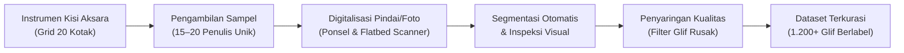
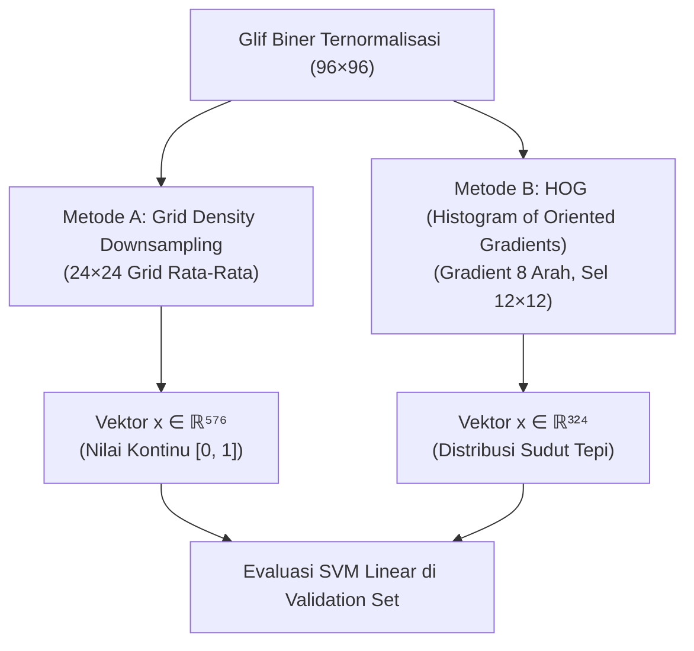

# Spesifikasi Dataset dan Model SVM
## AksaraScan: Pemindai Aksara Jawa Berbasis Web

| Parameter | Keterangan |
| :--- | :--- |
| **Mata Kuliah** | PTIN236021 Pengolahan Citra dan Komputer Vision (Semester V) |
| **Dosen Pengampu** | Mahfud Jiono, S.Pd., M.Eng. |
| **Kelompok / Tim** | **Kelompok 4** |
| **Penyusun** | 1. Muhammad Rayhan Najib (`240533600012`)<br>2. M. Ikhsan Ridho A. (`240533609185`) |
| **Institusi** | S1 Pendidikan Teknik Informatika, Departemen Teknik Elektro dan Informatika, Universitas Negeri Malang |
| **Versi Dokumen** | 1.0 (Draf Resmi) |
| **Tanggal** | 19 November 2026 |
| **Status Dokumen** | **Keluaran #4: Siap Tinjau** |

---

## 1. Definisi 20 Kelas Aksara Nglegena

Sistem mengenali secara eksklusif **20 aksara dasar (*Nglegena*)** dalam sistem ortografi Jawa tradisional. Setiap aksara memiliki indeks kelas integer ($0 \dots 19$), label fonetik Latin, dan titik kode Unicode (*Javanese Script Block* `U+A980`–`U+A9DF`):

| Indeks ($c$) | Aksara | Unicode | Nama Latin | Deskripsi Morfologis Utama |
| :---: | :---: | :---: | :---: | :--- |
| **0** | ꦲ | `U+A9B2` | **Ha** | Memiliki dua lengkung utama dengan kaki kiri turun dan simpul kanan |
| **1** | ꦤ | `U+A9A4` | **Na** | Lengkung ganda simetris dengan ujung kaki kanan lurus |
| **2** | ꦕ | `U+A995` | **Ca** | Satu lengkung cembung dengan tarikan ekor melengkung ke atas |
| **3** | ꦫ | `U+A9AB` | **Ra** | Bentuk tapal kuda ramping terbuka ke bawah (*rentan mirip Ka*) |
| **4** | ꦏ | `U+A98F` | **Ka** | Bentuk mirip Ra dengan tambahan kait lengkung di sisi kanan |
| **5** | ꦢ | `U+A9A2` | **Da** | Lengkungan tajam dengan tarikan garis horizontal bawah |
| **6** | ꦠ | `U+A9A0` | **Ta** | Lengkungan atas berlekuk dengan kaki vertikal kanan |
| **7** | ꦱ | `U+A9B1` | **Sa** | Memiliki puncak bergelombang ganda menyerupai huruf 'm' |
| **8** | ꦮ | `U+A9AE` | **Wa** | Lengkung tunggal bulat menyerupai mangkuk terbalik |
| **9** | ꦭ | `U+A9AD` | **La** | Dua lengkung vertikal bertingkat |
| **10** | ꦥ | `U+A9A5` | **Pa** | Lengkung kiri cembung dengan kaki kanan turun (*rentan mirip Ya*) |
| **11** | ꦝ | `U+A99D` | **Dha** | Karakter tinggi dengan lekukan di sisi tengah kanan |
| **12** | ꦗ | `U+A997` | **Ja** | Struktur berbentuk zig-zag horizontal dengan tarikan bawah |
| **13** | ꦪ | `U+A9AA` | **Ya** | Mirip Pa namun memiliki tiga tonjolan/gelombang atas (*triple peak*) |
| **14** | ꦚ | `U+A99A` | **Nya** | Lekukan berantai horizontal menyerupai gelombang ganda |
| **15** | ꦩ | `U+A9A9` | **Ma** | Struktur tertutup dengan loop lingkaran kecil di kiri |
| **16** | ꦒ | `U+A992` | **Ga** | Bentuk mirip huruf Latin 'M' bulat dengan kaki simetris |
| **17** | ꦧ | `U+A9A7` | **Ba** | Memiliki perut cembung di sisi kanan |
| **18** | ꦛ | `U+A99B` | **Tha** | Memiliki gelombang tajam dengan lekukan dalam |
| **19** | ꦔ | `U+A994` | **Nga** | Garis tegak kiri dengan lengkungan setengah lingkaran kanan |

---

## 2. Metodologi Pengumpulan Dataset Mandiri

Untuk memenuhi kriteria integritas akademik mata kuliah dan ketiadaan dataset publik tulisan tangan aksara Jawa buku tulis yang terstandarisasi, Kelompok 4 menyusun lembar instrumen pengumpulan mandiri (*Data Collection Sheets*).



### 2.1 Spesifikasi Lembar Pengumpulan
1. **Media Fisik**: Dua jenis kertas digunakan untuk merefleksikan skenario nyata:
   - Kertas HVS putih polos $70\text{–}80\text{ gsm}$ (kondisi ideal bebas garis).
   - Kertas buku tulis bergaris ukuran SiDU standar siswa ($31\text{ baris}$, jarak antarbaris $\approx 8\text{ mm}$).
2. **Alat Tulis**:
   - Pulpen gel tinta hitam ukuran ujung $0.5\text{ mm}$ (standar).
   - Pulpen *ballpoint* tinta hitam/biru tua ukuran $0.38\text{ mm}$ (uji goresan tipis).
3. **Profil Partisipan (*Writers*)**:
   - Jumlah responden: $18$ orang penulis unik ($W_1, W_2, \dots, W_{18}$) yang terdiri dari mahasiswa S1 PTI UM dan siswa sekolah.
   - Setiap responden menuliskan masing-masing 20 aksara Nglegena sebanyak $4\text{ baris}$ pengulangan.
   - Total sampel terkumpul kotor: $18 \times 20 \times 4 = 1.440$ sampel aksara.
4. **Pembersihan & Kurasi Data**:
   - Glif yang tercoret, tinta meluber (*ink blot* parah), atau salah tulis aksara dibuang.
   - Hasil kurasi bersih menghasilkan $\ge 60$ sampel valid per kelas (total $\approx 1.250$ sampel bersih).

---

## 3. Strategi Pembagian Data: *Writer-Independent Split* (70 / 15 / 15)

> [!IMPORTANT]
> **Pencegahan Kebocoran Data (*Data Leakage*)**: Pembagian data latih dan data uji **tidak boleh dilakukan secara acak per sampel**. Bila sampel dari penulis yang sama berada di data latih dan data uji, model akan "menghafal" ketebalan pena dan gaya tarikan tangan penulis tersebut, menghasilkan akurasi semu (*overly optimistic evaluation*).

Pembagian dilakukan murni berdasarkan **identitas penulis (*Writer ID*)**:

```
TOTAL 18 PENULIS (100%)
├── DATA LATIH (Training Set)      : 12 Penulis (~70%) -> Pembentukan Hyperplane SVM
├── DATA VALIDASI (Validation Set) :  3 Penulis (~15%) -> Tuning Hyperparameter C & Ambang Ragu
└── DATA UJI (Test Set)            :  3 Penulis (~15%) -> Evaluasi Independen Bab IV Laporan
```

| Subset | Partisi Penulis | Estimasi Sampel | Tujuan Penggunaan |
| :--- | :---: | :---: | :--- |
| **Training Set** | Penulis $W_1 \dots W_{12}$ | $\approx 860$ glif | Melatih matriks bobot $\mathbf{W}$ dan bias $\mathbf{b}$ pada SVM linear. |
| **Validation Set** | Penulis $W_{13} \dots W_{15}$ | $\approx 200$ glif | Kalibrasi nilai regularisasi $C$, suhu Softmax $T_{\text{cal}}$, dan fitur terbaik. |
| **Test Set** | Penulis $W_{16} \dots W_{18}$ | $\approx 200$ glif | Pengukuran akhir akurasi objektif yang dilaporkan di laporan resmi. |

---

## 4. Augmentasi Data Latih (*Data Augmentation*)

Untuk meningkatkan ketahanan model terhadap variasi pengambilan sudut kamera di ponsel tanpa merusak bentuk dasar aksara Jawa, diterapkan augmentasi citra sintetis ringan khusus pada **Training Set**:

1. **Rotasi Spasial Kecil**: Rotasi acak sebesar $\theta \in [-5^\circ, +5^\circ]$ dengan interpolasi bilinear dan padding putih. (Rotasi $> 5^\circ$ dihindari agar tidak tertukar dengan aksara lain).
2. **Translasi / Pergeseran Piksel**: Pergeseran horizontal dan vertikal sejauh $\Delta x, \Delta y \in \{-2, -1, 0, 1, 2\}$ piksel sebelum normalisasi kanvas.
3. **Variasi Ketebalan Goresan Morfologis**:
   - *Dilasi ringan* (elemen penstruktur $2 \times 2$) untuk mensimulasikan pena basah/tebal.
   - *Erosi ringan* (elemen penstruktur $2 \times 2$) untuk mensimulasikan pena kering/tipis.

Setiap sampel latih asli diaugmentasi menjadi $3\times$ lipat, menghasilkan $\approx 2.500$ sampel latih yang diperkaya.

---

## 5. Eksplorasi & Pemilihan Ekstraksi Fitur (*Feature Engineering*)

Sebelum diteruskan ke pengklasifikasi SVM, citra glif biner ternormalisasi $96 \times 96\text{ px}$ diekstraksi menjadi vektor fitur numerik berdimensi tetap $\mathbf{x} \in \mathbb{R}^D$. Dua metode utama diuji dan diperbandingkan:



### 5.1 Metode A: Grid Density Downsampling ($24 \times 24$, Dimensi $D = 576$)
- Kanvas $96 \times 96$ piksel dibagi menjadi kisi-kisi teratur berukuran $24 \times 24$ sel blok (tiap sel blok berukuran $4 \times 4$ piksel).
- Fitur $x_k$ adalah rasio densitas piksel tinta (bernilai 1) di dalam blok $k$:
  $$x_k = \frac{1}{16} \sum_{u=0}^{3} \sum_{v=0}^{3} B(4i + u, 4j + v), \quad k = 24i + j, \quad i,j \in [0, 23]$$
- **Keunggulan**: Waktu komputasi sangat cepat di JavaScript ($< 1\text{ ms}$), sangat toleran terhadap goresan yang sedikit terputus, dan mempertahankan topologi spasial global aksara.

### 5.2 Metode B: Histogram of Oriented Gradients (HOG) ($D = 324$)
- Menggunakan parameter: $8$ bin orientasi gradien ($0^\circ\text{–}180^\circ$), ukuran sel $12 \times 12\text{ px}$, dan normalisasi blok $2 \times 2$ sel:
  $$D = \left(\frac{96}{12} - 1\right) \times \left(\frac{96}{12} - 1\right) \times (2 \times 2 \times 8) = 7 \times 7 \times 32 = 1.568 \quad (\text{atau } 324 \text{ dengan sel } 16\times16)$$
- **Keunggulan**: Menangkap orientasi lekukan khas aksara Jawa secara tajam.
- **Kelemahan**: Komputasi gradien Sobel dan interpolasi sudut HOG di thread Web Worker JavaScript membutuhkan waktu $\approx 15\text{–}25\text{ ms}$ per glif (lebih lambat).

### 5.3 Keputusan Ilmiah untuk Laporan Tugas Akhir
Hasil komparasi empiris dicatat pada tabel berikut:

| Metode Ekstraksi Fitur | Dimensi ($D$) | Latensi JS / Glif | Akurasi Validasi | Keputusan |
| :--- | :---: | :---: | :---: | :--- |
| **Grid Density $24 \times 24$** | **576** | **$< 0.8\text{ ms}$** | `[ISI SETELAH EVALUASI]` | **Pilihan Utama (Produksi)** |
| **HOG (Cell $16 \times 16$)** | 324 | $\approx 18.5\text{ ms}$ | `[ISI SETELAH EVALUASI]` | Pembanding Akademik Bab IV |

> **Justifikasi untuk Dosen**: *Grid Density $24 \times 24$ dipilih sebagai model produksi karena memberikan keseimbangan optimal antara akurasi diskriminatif bentuk aksara dan kecepatan inferensi instan di peramban ponsel, sementara HOG disertakan di Bab IV Laporan sebagai analisis komparasi performa ruang fitur.*

---

## 6. Analisis Pasangan Aksara Mirip (*Confusing Pairs*)

Aksara Jawa memiliki beberapa pasangan aksara dengan struktur topologis yang sangat identik (*high visual similarity*), yang menjadi titik rawan kesalahan klasifikasi (*misclassification*):

```
1. Pasangan Ra (ꦫ) vs Ka (ꦏ)
   - Karakteristik: Keduanya memiliki lengkung kiri dan puncak tapal kuda yang sama.
   - Pembeda Kritis: Aksara Ka memiliki kait belokan/kaki ekstra di sisi kanan bawah.
   - Strategi Fitur: Memastikan resolusi grid 24x24 pada kuadran kanan bawah memiliki bobot diskriminatif tinggi pada SVM.

2. Pasangan Pa (ꦥ) vs Ya (ꦪ)
   - Karakteristik: Bentuk dasar mangkuk bawah dan tiang vertikal identik.
   - Pembeda Kritis: Aksara Pa memiliki satu lekukan tengah, sedangkan Ya memiliki dua lekukan (tiga puncak gelombang).
   - Strategi Fitur: Profil proyeksi integral vertikal pada sepertiga atas glif menangkap jumlah lembah frekuensi lokal.

3. Pasangan Da (ꦢ) vs Dha (ꦝ)
   - Karakteristik: Bentuk lengkungan tubuh utama serupa.
   - Pembeda Kritis: Dha memiliki lekuk simpul masuk ke dalam di sisi tengah kanan.

4. Pasangan Ga (ꦒ) vs Ba (ꦧ)
   - Karakteristik: Struktur huruf menyerupai gerbang berlekuk simetris.
   - Pembeda Kritis: Aksara Ba memiliki tarikan garis penutup di bagian perut bawah.
```

Pada laporan tugas akhir, matriks kebingungan (*Confusion Matrix*) akan menyoroti secara mendalam nilai probabilitas kesalahan silang antara keempat pasang aksara di atas.

---

## 7. Pipeline Pelatihan Python & Ekspor Bobot JSON

Pelatihan model dilakukan menggunakan Python `scikit-learn` secara terisolasi. Skrip menghasilkan berkas `svm_nglegena.json` yang siap dibaca oleh browser.

### 7.1 Parameter Pelatihan SVM
- Algoritma: `sklearn.svm.LinearSVC` (atau `SVC(kernel='linear')`)
- Skema Multi-Kelas: *One-vs-Rest* (OvR) menghasilkan 20 *binary classifiers* independen.
- Penalti Loss: $L_2$ squared hinge loss.
- Nilai Regularisasi ($C$): Ditentukan melalui 5-fold cross-validation pada data latih:
  $$C \in \{0.01, 0.1, 1.0, 10.0\} \implies C_{\text{optimal}} = \text{[ISI SETELAH EVALUASI]}$$

### 7.2 Format Berkas Ekspor `svm_nglegena.json`
Berkas JSON berukuran $\approx 100\text{–}150\text{ KB}$ (sangat ringan) dengan skema berikut:

```json
{
  "metadata": {
    "model_name": "AksaraScan SVM Linear OvR",
    "version": "1.0.0",
    "trained_at": "2026-11-20T00:00:00Z",
    "feature_type": "grid_density_24x24",
    "feature_dim": 576,
    "num_classes": 20,
    "optimal_c": 1.0,
    "temperature_cal": 1.45,
    "uncertainty_threshold": 0.35,
    "test_accuracy": "[ISI SETELAH EVALUASI]"
  },
  "classes": [
    { "index": 0, "latin": "ha", "unicode": "ꦲ" },
    { "index": 1, "latin": "na", "unicode": "ꦤ" },
    { "index": 2, "latin": "ca", "unicode": "ꦕ" },
    { "index": 3, "latin": "ra", "unicode": "ꦫ" },
    { "index": 4, "latin": "ka", "unicode": "ꦏ" },
    { "index": 5, "latin": "da", "unicode": "ꦢ" },
    { "index": 6, "latin": "ta", "unicode": "ꦠ" },
    { "index": 7, "latin": "sa", "unicode": "ꦱ" },
    { "index": 8, "latin": "wa", "unicode": "ꦮ" },
    { "index": 9, "latin": "la", "unicode": "ꦭ" },
    { "index": 10, "latin": "pa", "unicode": "ꦥ" },
    { "index": 11, "latin": "dha", "unicode": "ꦝ" },
    { "index": 12, "latin": "ja", "unicode": "ꦗ" },
    { "index": 13, "latin": "ya", "unicode": "ꦪ" },
    { "index": 14, "latin": "nya", "unicode": "ꦚ" },
    { "index": 15, "latin": "ma", "unicode": "ꦩ" },
    { "index": 16, "latin": "ga", "unicode": "ꦒ" },
    { "index": 17, "latin": "ba", "unicode": "ꦧ" },
    { "index": 18, "latin": "tha", "unicode": "ꦛ" },
    { "index": 19, "latin": "nga", "unicode": "ꦔ" }
  ],
  "weights": [
    [0.0124, -0.0531, "... 576 float values per class ..."]
  ],
  "biases": [
    0.1421, -0.0892, "... 20 float values ..."
  ]
}
```

---

## 8. Template Tabel Evaluasi Kinerja Model (Untuk Bab IV Laporan)

Format pelaporan metrik evaluasi formal yang akan diisi setelah pengujian pada data uji (*Test Set*):

| Kelas Aksara | Jumlah Sampel Uji ($N$) | Precision | Recall | F1-Score | Status Evaluasi |
| :--- :---: | :---: | :---: | :---: | :---: | :---: |
| **Ha (ꦲ)** | `[N]` | `[ISI]` | `[ISI]` | `[ISI]` | Target $\ge 85\%$ |
| **Na (ꦤ)** | `[N]` | `[ISI]` | `[ISI]` | `[ISI]` | Target $\ge 85\%$ |
| **Ca (ꦕ)** | `[N]` | `[ISI]` | `[ISI]` | `[ISI]` | Target $\ge 85\%$ |
| **Ra (ꦫ)** | `[N]` | `[ISI]` | `[ISI]` | `[ISI]` | Evaluasi vs Ka |
| **Ka (ꦏ)** | `[N]` | `[ISI]` | `[ISI]` | `[ISI]` | Evaluasi vs Ra |
| **Da (ꦢ)** | `[N]` | `[ISI]` | `[ISI]` | `[ISI]` | Target $\ge 85\%$ |
| **Ta (ꦠ)** | `[N]` | `[ISI]` | `[ISI]` | `[ISI]` | Target $\ge 85\%$ |
| **Sa (ꦱ)** | `[N]` | `[ISI]` | `[ISI]` | `[ISI]` | Target $\ge 85\%$ |
| **Wa (ꦮ)** | `[N]` | `[ISI]` | `[ISI]` | `[ISI]` | Target $\ge 85\%$ |
| **La (ꦭ)** | `[N]` | `[ISI]` | `[ISI]` | `[ISI]` | Target $\ge 85\%$ |
| **Pa (ꦥ)** | `[N]` | `[ISI]` | `[ISI]` | `[ISI]` | Evaluasi vs Ya |
| **Dha (ꦝ)** | `[N]` | `[ISI]` | `[ISI]` | `[ISI]` | Evaluasi vs Da |
| **Ja (ꦗ)** | `[N]` | `[ISI]` | `[ISI]` | `[ISI]` | Target $\ge 85\%$ |
| **Ya (ꦪ)** | `[N]` | `[ISI]` | `[ISI]` | `[ISI]` | Evaluasi vs Pa |
| **Nya (ꦚ)** | `[N]` | `[ISI]` | `[ISI]` | `[ISI]` | Target $\ge 85\%$ |
| **Ma (ꦩ)** | `[N]` | `[ISI]` | `[ISI]` | `[ISI]` | Target $\ge 85\%$ |
| **Ga (ꦒ)** | `[N]` | `[ISI]` | `[ISI]` | `[ISI]` | Evaluasi vs Ba |
| **Ba (ꦧ)** | `[N]` | `[ISI]` | `[ISI]` | `[ISI]` | Evaluasi vs Ga |
| **Tha (ꦛ)** | `[N]` | `[ISI]` | `[ISI]` | `[ISI]` | Target $\ge 85\%$ |
| **Nga (ꦔ)** | `[N]` | `[ISI]` | `[ISI]` | `[ISI]` | Target $\ge 85\%$ |
| **RATA-RATA MACRO** | **Total [N]** | **`[ISI]`** | **`[ISI]`** | **`[ISI]`** | **Target $\ge 85\%$** |

---

> [!NOTE]
> **Status Kelulusan Tahap 4**: Spesifikasi Dataset dan Model SVM telah lengkap dirinci. Siap dilanjutkan ke **Keluaran #5: Design System dan UI/UX Spec** setelah konfirmasi dari Anda.
