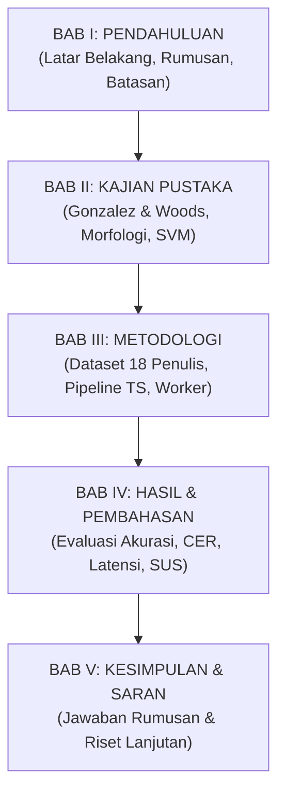

# Outline Laporan Tugas Akhir (Bab I–V)
## Deteksi Tulisan Tangan Aksara Jawa pada Buku Tulis Menggunakan Pengolahan Citra Digital dan Klasifikasi Karakter

| Parameter | Keterangan |
| :--- | :--- |
| **Mata Kuliah** | PTIN236021 Pengolahan Citra dan Komputer Vision (Semester V) |
| **Dosen Pengampu** | Mahfud Jiono, S.Pd., M.Eng. |
| **Kelompok / Tim** | **Kelompok 4** |
| **Penyusun** | 1. Muhammad Rayhan Najib (`240533600012`)<br>2. M. Ikhsan Ridho A. (`240533609185`) |
| **Institusi** | S1 Pendidikan Teknik Informatika, Departemen Teknik Elektro dan Informatika, Universitas Negeri Malang |
| **Versi Dokumen** | 1.0 (Draf Resmi) |
| **Tanggal** | 19 November 2026 |
| **Status Dokumen** | **Keluaran #7: Siap Tinjau** |

---

## 1. Struktur Formal Halaman Awal (*Front Matter*)

```
HALAMAN JUDUL (Bahasa Indonesia & Bahasa Inggris)
LEMBAR PENGESAHAN (Ditandatangani Dosen Pengampu: Mahfud Jiono, S.Pd., M.Eng.)
SURAT PERNYATAAN KEASLIAN KARYA
ABSTRAK (Bahasa Indonesia, Maksimal 250 kata, 5 Kata Kunci)
ABSTRACT (Bahasa Inggris)
KATA PENGANTAR
DAFTAR ISI
DAFTAR TABEL
DAFTAR GAMBAR
DAFTAR LAMPIRAN
DAFTAR SIMBOL DAN SINGKATAN
```

---

## 2. Rincian Sistematika Bab I s/d Bab V



---

### BAB I: PENDAHULUAN

* **1.1 Latar Belakang Masalah**
  * Urgensi pelestarian Aksara Jawa (*Hanacaraka*) sebagai warisan budaya bangsa yang mulai terpinggirkan di kalangan generasi muda.
  * Kendala siswa SMP/SMA dan masyarakat dalam memverifikasi kebenaran tulisan tangan pada lembar kerja/buku catatan bahasa Jawa tanpa pendampingan guru.
  * Keterbatasan aplikasi pemindai dokumen komersial (*CamScanner, Google Lens*) yang tidak mengenali ortografi aksara Jawa tulisan tangan dan memiliki ketergantungan mutlak pada server awan (*cloud OCR*).
  * Kebutuhan akademik mata kuliah PTIN236021: Menghadirkan sistem pengenalan pola yang transparan secara matematis pada domain citra klasik tanpa model kotak hitam (*black-box deep learning*).
* **1.2 Rumusan Masalah**
  1. Bagaimana merancang dan mengimplementasikan pipeline pengolahan citra digital mandiri di sisi klien (*client-only*) untuk mendeteksi 20 aksara Jawa dasar (*Nglegena*) dari foto buku tulis?
  2. Bagaimana kinerja akurasi pengenalan karakter menggunakan model Support Vector Machine (SVM) Linear dengan evaluasi *writer-independent*?
  3. Bagaimana efisiensi waktu komputasi pemrosesan citra pada peramban web ponsel pintar (*smartphone*) tanpa memblokir thread antarmuka pengguna?
* **1.3 Batasan Masalah**
  * Pengenalan dibatasi pada 20 aksara dasar (*Nglegena*) tanpa *sandhangan* dan *pasangan*.
  * Masukan citra berupa tulisan tangan diskret (tidak bersambung) menggunakan tinta gelap pada kertas putih polos atau buku bergaris SiDU dengan kemiringan baris $\le 10^\circ$.
  * Komputasi dieksekusi murni di peramban pengguna (*zero backend server*).
* **1.4 Tujuan Penelitian**
  * Mengembangkan aplikasi web **AksaraScan** sebagai alat pemindai aksara Jawa mandiri, cepat, dan menjaga privasi pengguna.
  * Menerapkan dan menguji efektivitas metode binerisasi Otsu, filter median, operasi morfologi pembersih garis buku, segmentasi proyeksi integral, dan SVM linear.
* **1.5 Manfaat Penelitian**
  * *Manfaat Teoritis*: Menjadi rujukan ilmiah penerapan terpadu materi silabus Pengolahan Citra Digital (Gonzalez & Woods Bab 2, 3, 9, 10, 11).
  * *Manfaat Praktis*: Membantu siswa memeriksa PR mandiri dan menyediakan media ajar interaktif bagi guru (*Lab Pipeline*).

---

### BAB II: KAJIAN PUSTAKA DAN LANDASAN TEORI

* **2.1 Penelitian Terkait (*State of the Art*)**
  * Tinjauan penelitian terdahulu mengenai OCR Aksara Jawa (metode ekstraksi kontur, template matching, dan machine learning).
  * Komparasi kelebihan pendekatan citra klasik berbasis *feature engineering* dibanding *deep learning* untuk lingkungan peramban web berdaya rendah.
* **2.2 Anatomi Ortografi 20 Aksara Nglegena**
  * Struktur morfologi huruf Ha hingga Nga, titik kode Unicode standar, serta analisis kemiripan visual pada pasangan rentan tertukar (*confusing pairs*: Ra/Ka, Pa/Ya, Da/Dha, Ga/Ba).
* **2.3 Landasan Teori Pengolahan Citra Digital (Gonzalez & Woods)**
  * *2.3.1 Matriks Citra & Luminansi Grayscale (Bab 2)*: Representasi spasial $f(x,y)$ dan konversi ITU-R BT.601 ($0.299R + 0.587G + 0.114B$).
  * *2.3.2 Binerisasi Ambang Batas Otsu (Bab 3 & 10)*: Pemisahan latar belakang bimodal berbasis maksimasi variansi antarkelas $\sigma_B^2(T)$.
  * *2.3.3 Filter Spasial Median (Bab 3)*: Reduksi derau impulsif bintik kertas (*salt-and-pepper*) berbasis statistik urutan non-linear.
  * *2.3.4 Morfologi Citra Matematis (Bab 9)*: Teori erosi ($\ominus$), dilasi ($\oplus$), *opening* ($\circ$), *closing* ($\bullet$), serta formulasi penghapusan garis buku menggunakan elemen penstruktur horizontal $1 \times 21\text{ px}$.
  * *2.3.5 Segmentasi Spasial Citra (Bab 10 & 11)*: Proyeksi integral horizontal $\sum_x I(x,y)$, proyeksi vertikal $\sum_y I(x,y)$, dan pelabelan komponen terhubung (*Connected Components Labeling* 8-arah).
  * *2.3.6 Normalisasi Glif Isotropik (Bab 11)*: Transformasi skala kanvas $96 \times 96\text{ px}$ dengan pemeliharaan rasio aspek (*aspect ratio*).
* **2.4 Ekstraksi Fitur Citra Karakter**
  * Formulasi *Grid Density Downsampling* $24 \times 24$ ($D=576$) dan *Histogram of Oriented Gradients* (HOG).
* **2.5 Support Vector Machine (SVM) Linear**
  * Konsep pemisah margin maksimal (*maximum margin hyperplane*), skema multi-kelas *One-vs-Rest* (OvR), serta kalibrasi probabilitas fungsi Softmax.
* **2.6 Arsitektur Perangkat Lunak Web Modern**
  * Konsep *Single Page Application* (React), komputasi latar *Web Worker*, dan caching *Progressive Web Apps* (PWA).

---

### BAB III: METODOLOGI PENELITIAN DAN PERANCANGAN SISTEM

* **3.1 Diagram Alir Penelitian (*Research Framework*)**
  * Tahap 1: Pengumpulan instrumen $\rightarrow$ Tahap 2: Praproses & kurasi $\rightarrow$ Tahap 3: Pelatihan SVM offline $\rightarrow$ Tahap 4: Rekayasa pipeline TypeScript $\rightarrow$ Tahap 5: Pengujian sistem.
* **3.2 Pengumpulan dan Kurasi Dataset Mandiri**
  * Protokol lembar isian 18 penulis unik pada media kertas HVS dan kertas bergaris SiDU.
  * Pembagian partisi bebas penulis (*Writer-Independent Split* 70% latih / 15% validasi / 15% uji).
  * Prosedur augmentasi data latih (rotasi $\pm 5^\circ$, translasi $\pm 2\text{ px}$, dilasi/erosi).
* **3.3 Perancangan Arsitektur Sistem AksaraScan**
  * Desain pemisahan thread: Main UI Thread (React + Zustand) dan Background Thread (`pipeline.worker.ts`).
  * Protokol pesan biner bertipe (*Typed Worker Messaging*) menggunakan *Transferable Objects* `ImageBitmap`.
* **3.4 Implementasi Matematis Pipeline Citra di TypeScript**
  * Algoritma konversi grayscale, loop pencarian ambang Otsu, sorting median window $3\times3$, operasi morfologi garis buku, deteksi lembah proyeksi, dan normalisasi kanvas $96 \times 96\text{ px}$.
* **3.5 Pelatihan Model SVM & Ekspor Format JSON**
  * Konfigurasi pelatihan Python scikit-learn (`LinearSVC`), pencarian parameter $C$ optimal via 5-fold CV, dan struktur berkas `svm_nglegena.json`.
* **3.6 Perancangan Desain Antarmuka Pengguna (*Design System*)**
  * Penerapan tema "Manuskrip Modern", palet token warna budaya (*sogan, wulung, prada*), tipografi Noto Sans Javanese, dan tata letak 7 layar inti.
* **3.7 Rencana dan Skenario Pengujian**
  * Parameter pengujian unit (Vitest), 10 citra golden, pengujian 3 perangkat fisik, dan instrumen System Usability Scale (SUS).

---

### BAB IV: HASIL DAN PEMBAHASAN

* **4.1 Hasil Implementasi Sistem AksaraScan**
  * Tampilan tangkapan layar antarmuka: Beranda, Pemindai Kamera, Pangkas 4-Sudut, Hasil Pindaian dengan Bounding Box, dan Lab Pipeline 7 Tahap.
* **4.2 Analisis Kualitatif Hasil Tahapan Pipeline Citra**
  * Verifikasi visual langkah demi langkah: Citra Asli $\rightarrow$ Grayscale $\rightarrow$ Otsu $\rightarrow$ Median $\rightarrow$ Morfologi $\rightarrow$ Segmentasi Baris/Karakter $\rightarrow$ Normalisasi.
  * Evaluasi efektivitas eliminasi garis horizontal buku tulis SiDU tanpa merusak goresan vertikal aksara.
* **4.3 Evaluasi Kinerja Model Pengenalan Karakter**
  * Pembahasan tabel akurasi, Precision, Recall, dan F1-Score per kelas pada data uji independen.
  * Analisis *Confusion Matrix*: Evaluasi tingkat kesalahan klasifikasi pada pasangan mirip (Ra/Ka, Pa/Ya, Da/Dha, Ga/Ba).
  * Komparasi performa ruang fitur: Grid Density $24 \times 24$ vs HOG.
* **4.4 Evaluasi Kinerja Komputasi dan Latensi Sistem**
  * Pembahasan hasil pengujian latensi per tahap pada 3 perangkat uji (DEV-01 Ponsel Mid, DEV-02 Ponsel Entry, DEV-03 Laptop Core i5).
  * Analisis kestabilan FPS antarmuka pengguna selama eksekusi Web Worker.
* **4.5 Evaluasi Pengujian Ujung-ke-Ujung pada 30 Foto Nyata**
  * Analisis Character Error Rate (CER) pada naskah tulisan tangan kertas HVS vs kertas bergaris vs kondisi miring/berbayang.
* **4.6 Hasil Evaluasi Kegunaan Pengguna (*Usability Testing*)**
  * Analisis skor kuesioner System Usability Scale (SUS) dari 10 responden dan tingkat keberhasilan tugas mandiri.
* **4.7 Pembahasan Akademik Ketercapaian Terhadap Silabus PTIN236021**
  * Refleksi teoritis kesesuaian implementasi sistem dengan materi buku Gonzalez & Woods.

---

### BAB V: KESIMPULAN DAN SARAN

* **5.1 Kesimpulan**
  * Jawaban kuantitatif dan kualitatif atas ketiga rumusan masalah berdasarkan data empiris Bab IV.
* **5.2 Saran dan Pengembangan Lanjutan**
  * Penambahan pengenalan sistem diakritik (*sandhangan*) dan pasangan pada riset masa depan.
  * Penerapan algoritma deteksi tepi dokumen otomatis (*auto-warp perspective correction*).
  * Eksplorasi kompilasi modul citra ke WebAssembly (Wasm) untuk penghematan daya baterai perangkat ponsel lawas.

---

## 3. Format Daftar Pustaka Standar IEEE

Berikut format acuan pustaka primer yang wajib dicantumkan dalam laporan:

1. R. C. Gonzalez and R. E. Woods, *Digital Image Processing*, 4th ed. New York, NY, USA: Pearson, 2018.
2. N. Otsu, "A threshold selection method from gray-level histograms," *IEEE Trans. Syst., Man, Cybern.*, vol. 9, no. 1, pp. 62–66, Jan. 1979.
3. C. Cortes and V. Vapnik, "Support-vector networks," *Machine Learning*, vol. 20, no. 3, pp. 273–297, Sep. 1995.
4. N. Dalal and B. Triggs, "Histograms of oriented gradients for human detection," in *Proc. IEEE Comput. Soc. Conf. Comput. Vis. Pattern Recognit. (CVPR)*, San Diego, CA, USA, 2005, pp. 886–893.
5. J. Brooke, "SUS: A 'quick and dirty' usability scale," in *Usability Evaluation in Industry*, P. W. Jordan, B. Thomas, I. L. McClelland, and B. Weerdmeester, Eds. London, UK: Taylor & Francis, 1996, pp. 189–194.
6. Badan Pengembangan dan Pembinaan Bahasa, *Pedoman Penulisan Aksara Jawa*. Jakarta: Kementerian Pendidikan, Kebudayaan, Riset, dan Teknologi, 2021.

---

## 4. Struktur Lampiran (*Appendices*)

* **Lampiran A**: Format Lembar Instrumen Pengambilan Sampel Tulisan Tangan 20 Aksara Nglegena.
* **Lampiran B**: Lembar Matriks Evaluasi Confusion Matrix Lengkap.
* **Lampiran C**: Kuesioner SUS dan Rekapitulasi Nilai Mentah 10 Responden.
* **Lampiran D**: Potongan Kode Sumber Kunci TypeScript (`otsu.ts`, `morphology.ts`, `projection.ts`).
* **Lampiran E**: Dokumentasi Foto Pengujian Sistem Bersama Responden dan Tangkapan Layar Aplikasi.

---

> [!NOTE]
> **Status Kelulusan Tahap 7**: Outline Laporan Tugas Akhir telah lengkap dan terstruktur rapi. Siap dilanjutkan ke **Keluaran #8: Outline Slide Presentasi dan Skrip Demo 5 Menit** setelah konfirmasi dari Anda.
