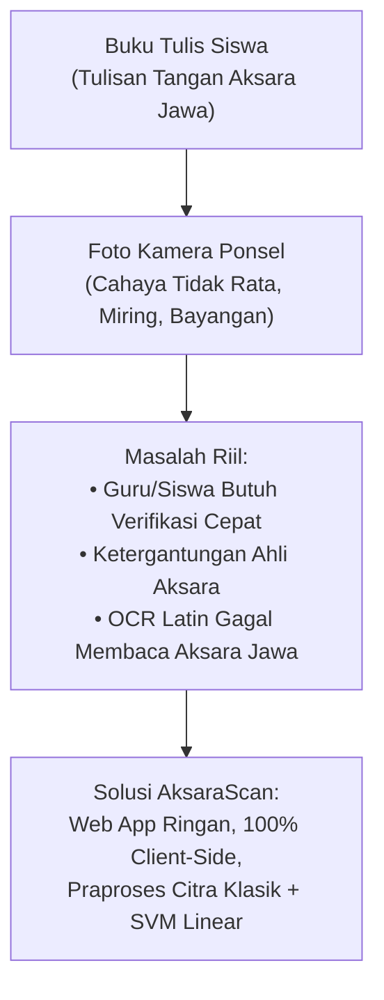
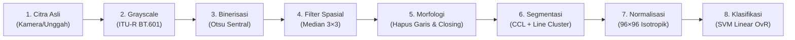

# Panduan Komprehensif Presentasi Tugas Akhir: AksaraScan
## Pemindai Aksara Jawa Berbasis Web: Segmentasi Spasial, Morfologi, dan Klasifikasi SVM untuk Desktop dan Ponsel

| Parameter Akademik | Keterangan Dokumen |
| :--- | :--- |
| **Mata Kuliah** | PTIN236021 Pengolahan Citra dan Komputer Vision (Semester V) |
| **Dosen Pengampu** | Mahfud Jiono, S.Pd., M.Eng. |
| **Kelompok / Tim** | **Kelompok 4** |
| **Penyaji / Presenter** | **Muhammad Rayhan Najib** (NIM: `240533600012`) |
| **Rekan Proyek** | M. Ikhsan Ridho A. (NIM: `240533609185`) |
| **Program Studi** | S1 Pendidikan Teknologi Informasi, Departemen Teknik Elektro dan Informatika, Universitas Negeri Malang |
| **Basis Materi** | Slide Presentasi Resmi (5 Slide) & Implementasi Aplikasi Web `web_camscanner` |

---

## 1. Ringkasan Eksekutif & Luaran Proyek (*Deliverables*)

### 1.1 Bentuk Luaran Nyata (*Concrete Deliverables*)
Proyek akhir **AksaraScan** menghasilkan produk perangkat lunak dan artefak akademik yang siap diuji secara langsung:
1. **Aplikasi Web Mandiri (*Client-Side Progressive Web App*)**:
   - Berjalan murni di browser (HTML5, CSS3 Modern, Vanilla JavaScript ES6+) tanpa memerlukan instalasi aplikasi pihak ketiga (*zero installation*).
   - Mengadopsi arsitektur *Single Page Application* (SPA) dengan tata letak responsif penuh (*fluid adaptive layout*), bekerja identik dari monitor desktop ($1440\text{ px}$) hingga layar ponsel cerdas ($390\text{ px}$).
2. **Mesin Inferensi Sisi Klien (*Browser-Native SVM Inference*)**:
   - Model klasifikasi Support Vector Machine (SVM) Linear berbobot 184.320 parameter ($20\text{ kelas} \times 9.216\text{ fitur}$) yang dikompresi dalam presisi `float16` Base64 di dalam berkas [model.json](file:///c:/Users/WA/Downloads/TUGAS%20PKKMB/Citra%20Komputer/Projek_Akhir/web_camscanner/model.json) dan [model.js](file:///c:/Users/WA/Downloads/TUGAS%20PKKMB/Citra%20Komputer/Projek_Akhir/web_camscanner/model.js).
   - Inferensi dilakukan secara instan ($< 250\text{ ms}$ untuk satu halaman dokumen) langsung pada CPU/memori perangkat pengguna tanpa latensi jaringan.
3. **Laboratorium Pengolahan Citra Digital (*Interactive Lab Pipeline Tab*)**:
   - Fitur transparansi akademik yang memungkinkan dosen dan pengguna menginspeksi citra hasil pemrosesan pada tiap tahap: Grayscale, Ambang Otsu + Histogram Dinamis, Filter Median, Morfologi Garis, Segmentasi Bounding Box, hingga Normalisasi Glif $96 \times 96$.
4. **Fitur Human-in-the-Loop (Modal Koreksi Interaktif & Kamus Hanacaraka)**:
   - Pengguna dapat mengetuk (*click/touch*) kotak pembatas (*bounding box*) pada kanvas utama untuk mengoreksi prediksi model yang ragu (*confidence* rendah) melalui modal interaktif 20 aksara Nglegena.
   - Hasil akhir dapat disalin langsung sebagai teks Unicode Aksara Jawa (`U+A980`–`U+A9DF`) dan teks fonetik Latin, serta diekspor ke format JSON.

---

## 2. Latar Belakang & Alasan Pemilihan Topik



### 2.1 Mengapa dari Buku Tulis ke Kamera Ponsel?
1. **Konteks Pembelajaran Muatan Lokal di Sekolah**:
   Mata pelajaran Bahasa Jawa di jenjang SD, SMP, hingga SMA di Jawa Timur dan Jawa Tengah mewajibkan kompetensi menulis dan membaca aksara Jawa (*Hanacaraka*). Seluruh tugas siswa dikerjakan secara manual di buku tulis bergaris menggunakan pena atau pensil.
2. **Keterbatasan Evaluasi Manual**:
   Guru memiliki keterbatasan waktu untuk mengoreksi puluhan buku tulis siswa secara manual huruf demi huruf. Di sisi lain, siswa yang belajar mandiri di rumah tidak memiliki alat pemverifikasi apakah aksara yang mereka tuliskan sudah tepat bentuk strukturnya atau keliru.
3. **Tantangan Lingkungan Pengambilan Citra Nyata**:
   Pemotretan lembar tugas siswa menggunakan kamera ponsel tidak berada di lingkungan laboratorium yang terkontrol:
   - Pencahayaan tidak merata (*uneven illumination* dan bayangan tangan/ponsel).
   - Posisi pengambilan gambar sering miring (*skewed orientation*).
   - Tinta pulpen memiliki ketebalan bervariasi (goresan tipis $0.38\text{ mm}$ hingga gel $0.5\text{ mm}$).
   - Kertas buku tulis memiliki **garis horizontal berpola** (seperti buku SiDU 31 baris) yang memotong badan aksara Jawa.

---

## 3. Kebaruan Sistem (*Novelty*) & Keunggulan Komparatif

| Dimensi Evaluasi | OCR Konvensional (Tesseract) | Deep Learning Berat (CNN / YOLO) | **AksaraScan (Sistem Ini)** |
| :--- | :--- | :--- | :--- |
| **Infrastruktur** | Butuh instalasi binary C++ di OS | Butuh Server GPU (VRAM besar, biaya cloud) | **Tanpa Server (*Zero Backend*)**, 100% Browser |
| **Privasi Data** | Tergantung konfigurasi | Citra dikirim ke server pihak ketiga | **Privasi Mutlak ($100\%$)**, citra tidak pernah keluar dari RAM ponsel |
| **Kebutuhan Bandwidth** | Sedang | Boros kuota (unggah foto resolusi tinggi) | **Hemat Kuota**, model di-cache sekali via PWA (offline) |
| **Transparansi Algoritma** | Kotak hitam (*Black-box*) | Kotak hitam (*Deep feature embedding*) | **Transparan Penuh (*Glass-box*)**, setiap tahapan matematis dapat diaudit di Tab Lab |
| **Kesesuaian Silabus** | Di luar silabus Pengolahan Citra S1 | Materi *Deep Learning* tingkat lanjut | **100% Selaras dengan Materi Silabus PCD Bab 1–9** |

### 3.1 Nilai Kebaruan Utama (*Core Novelty*)
1. **Pipeline Klasik Teroptimasi Khusus Aksara Jawa Silabis**:
   Mengombinasikan filter spasial, operasi morfologi subtraktif garis horizontal, dan analisis komponen terhubung (CCL) dengan *intra-glyph gap merging* yang secara cerdas menangani karakteristik unik aksara Jawa (aksara berkaki ganda seperti `ra`, `ka`, `ya`).
2. **Eksekusi SVM Linear Berbobot Terkompresi di Browser**:
   Membuktikan bahwa model pembelajaran mesin klasik (*linear classifier*) dapat diintegrasikan secara elegan ke dalam web modern menggunakan representasi biner terdistribusi ($96 \times 96$ piksel dengan normalisasi isotropik $76\text{ px}$) dan dieksekusi dengan operasi *dot product* secepat kilat.

---

## 4. Bedah Metodologi 8 Tahapan: Alasan, Rumus, dan Penerapan



---

### Tahap 1: Konversi Derajat Keabuan (*Grayscale Conversion*)
* **Alasan Pemilihan Metode**:
  Citra digital berwarna tersusun atas 3 kanal matriks ($R, G, B$) yang membutuhkan komputasi tiga kali lipat. Namun, informasi utama yang membedakan goresan tinta pena dan kertas adalah **intensitas luminansi**, bukan krominansi warna. Standar **ITU-R BT.601** dipilih karena koefisien bobotnya memperhitungkan respons biologis fotoreseptor mata manusia (*human visual system*) yang paling sensitif terhadap panjang gelombang hijau.
* **Formulasi Matematis**:
  $$Y(x, y) = 0.299 \cdot R(x, y) + 0.587 \cdot G(x, y) + 0.114 \cdot B(x, y)$$
* **Penerapan Teknis**:
  Setiap piksel $4\text{ byte}$ dari `ImageData` (`[R, G, B, A]`) diubah menjadi nilai skalar tunggal $Y \in [0, 255]$ dan disimpan dalam larik tipe data efisien `Uint8Array(w * h)`.

---

### Tahap 2: Binerisasi Ambang Batas Otsu (*Otsu Auto-Thresholding*)
* **Alasan Pemilihan Metode**:
  Penggunaan ambang batas statis (misal $T = 128$) akan gagal total ketika intensitas pencahayaan ruangan berubah atau foto memiliki bayangan. Algoritma **Nobuyuki Otsu (1979)** bekerja secara adaptif dan tanpa parameter (*unsupervised parameter-free*) dengan mencari nilai ambang $t^*$ yang memaksimalkan variansi antarkelas bimodal (*between-class variance* $\sigma_B^2$) antara tinta (objek) dan kertas (latar belakang).
* **Formulasi Matematis**:
  $$\sigma_B^2(t) = \omega_0(t) \cdot \omega_1(t) \cdot [\mu_0(t) - \mu_1(t)]^2$$
  Di mana:
  - $\omega_0(t) = \sum_{i=0}^{t} p(i)$ dan $\omega_1(t) = \sum_{i=t+1}^{255} p(i)$ adalah probabilitas kumulatif kelas objek dan latar.
  - $\mu_0(t)$ dan $\mu_1(t)$ adalah rata-rata intensitas masing-masing kelas.
  - Ambang optimal dipilih melalui pencarian: $t^* = \arg\max_{0 \le t \le 255} \sigma_B^2(t)$.
* **Inovasi Evaluasi Sentral (*Center-Sampling Heuristic*)**:
  Pada foto ponsel, tepi gambar sering memuat bayangan meja gelap atau batas pemindai yang merusak bimodalitas histogram. AksaraScan mengevaluasi histogram Otsu pada **wilayah sentral dokumen (margin $12\%$ dari tepi luar)**, menghasilkan nilai ambang yang sangat stabil ($t \approx 199$).
* **Aturan Binerisasi Inversi**:
  $$\text{bin}(x, y) = \begin{cases} 1 & \text{jika } Y(x, y) < t^* \quad (\text{Tinta / Objek}) \\ 0 & \text{jika } Y(x, y) \ge t^* \quad (\text{Kertas / Latar Belakang}) \end{cases}$$

---

### Tahap 3: Filter Spasial Median 3×3 (*Salt-and-Pepper Noise Reduction*)
* **Alasan Pemilihan Metode**:
  Kertas buku tulis memiliki tekstur serat kayu alami dan sensor kamera ponsel di kondisi minim cahaya kerap menghasilkan bintik derau impuls (*salt-and-pepper noise*). Filter linear rata-rata (*Mean Filter*) akan mengaburkan ketajaman tepi aksara (*blurring edges*), sedangkan filter non-linear **Median** sangat unggul mempertahankan tepi (*edge-preserving*).
* **Formulasi Matematis**:
  $$\text{med}(x, y) = \text{median} \{ \text{bin}(x + i, y + j) \mid -1 \le i, j \le 1 \}$$
* **Penyempurnaan Preservasi Goresan Tipis**:
  Pada goresan pulpen tipis berukuran 1–2 piksel, filter median biner murni ($\ge 5$ piksel) dapat memutus garis. AksaraScan menerapkan aturan median bersyarat: piksel tinta ($1$) dipertahankan jika memiliki $\ge 2$ tetangga aktif di jendela $3 \times 3$, dan lubang piksel ($0$) diisi jika dikelilingi $\ge 7$ piksel tinta (*pinhole filling*).

---

### Tahap 4: Morfologi Citra (Penghapusan Garis Buku & Penutupan Closing)
* **Alasan Pemilihan Metode**:
  1. *Eliminasi Garis Buku*: Buku tulis bergaris memiliki garis horizontal kontinu yang menembus aksara. Jika tidak dihilangkan, aksara dalam satu baris akan dianggap sebagai satu kesatuan objek raksasa.
  2. *Closing 3×3*: Tarikan pena manual sering kali menghasilkan keretakan mikro (*hairline fractures*) akibat kecepatan menulis atau tinta yang sedikit putus. Operasi penutupan (*closing*) menyambungkan kembali keretakan tersebut tanpa memperbesar dimensi luar aksara secara signifikan.
* **Formulasi Matematis**:
  1. **Deteksi Garis Horizontal** menggunakan elemen penstruktur garis $B_{\text{line}} = 1 \times K$ ($K \approx 19\text{ piksel}$):
     $$L = (I \ominus B_{\text{line}}) \oplus B_{\text{line}} = I \circ B_{\text{line}}$$
     Citra bersih diperoleh dari pengurangan logika: $I_{\text{clean}} = I \setminus L$.
  2. **Penutupan (*Closing*)** dengan elemen penstruktur kotak $B_{3 \times 3}$:
     $$I_{\text{closed}} = (I_{\text{clean}} \oplus B_{3 \times 3}) \ominus B_{3 \times 3}$$
     Di mana $\oplus$ adalah dilasi (mempertebal & menutup celah) dan $\ominus$ adalah erosi (mengembalikan ketebalan asli).

---

### Tahap 5 & 6: Segmentasi Spasial Komponen Terhubung 2D (CCL) & Pengelompokan Baris
* **Alasan Pemilihan Metode**:
  Metode proyeksi integral vertikal naif (*naive column projection*) memproyeksikan piksel ke sumbu-X: jika sebuah aksara memiliki rongga tengah (seperti aksara `ra` ꦫ, `ka` ꦏ, dan `ya` ꦪ yang memiliki dua hingga tiga kaki vertikal terpisah), proyeksi kolom akan bernilai $0$ di celah tengah, sehingga satu aksara terpotong menjadi 2–3 potongan kecil (*over-segmentation*).
  Oleh karena itu, sistem menggunakan kombinasi **Analisis Komponen Terhubung 2D (Connected Component Labeling - 8 Keterhubungan)** dan **Penggabungan Celah Intra-Aksara (*Intra-Glyph Gap Merging*)**.
* **Penerapan Algoritma**:
  1. **Ekstraksi Komponen (8-Way CCL via BFS)**:
     Setiap kelompok piksel tinta $1$ yang saling terhubung secara 8-arah diidentifikasi untuk menghitung luas area ($A$) dan koordinat kotak batas $[x_0, y_0, x_1, y_1]$. Komponen dengan $A < 35\text{ px}$ (derau debu) dan $A > 0.35 \times W \times H$ (batas lembar dokumen) disaring.
  2. **Pengelompokan Baris Teks (*Line Clustering*)**:
     Komponen dikelompokkan ke baris yang sama berdasarkan kedekatan titik pusat vertikal ($y_{\text{center}}$) dengan ambang batas adaptif $\Delta y < \max(20, 0.6 \times \bar{h})$.
  3. **Penggabungan Celah Intra-Aksara**:
     Di dalam setiap baris, komponen diurutkan dari kiri ke kanan. Jika dua komponen bersebelahan memiliki jarak horizontal sangat sempit ($\text{gap} < \max(14, 0.22 \times \bar{h})$) dan terjadi tumpang-tindih vertikal, kedua kotak batas digabungkan menjadi satu kesatuan glif aksara.

---

### Tahap 7: Normalisasi Glif Isotropik 96×96 (Inner 76px)
* **Alasan Pemilihan Metode**:
  Model klasifikasi SVM membutuhkan vektor masukan berdimensi tetap ($D = 96 \times 96 = 9.216$). Namun, ukuran tulisan tangan siswa sangat beragam. Jika dilakukan *resize* langsung ke $96 \times 96$ (*anisotropic stretching*), proporsi aspek aksara akan rusak (aksara kurus ramping akan melebar, aksara lebar akan tertekan).
* **Penerapan Normalisasi Isotropik**:
  1. Kotak glif aksara di-crop rapat (*tight bounding box*).
  2. Faktor skala isotropik dihitung berdasarkan sisi terpanjang:
     $$s = \frac{76}{\max(w_{\text{crop}}, h_{\text{crop}})}$$
  3. Glif diperkecil/diperbesar menjadi dimensi baru $w_{\text{new}} = \text{round}(w \cdot s)$ dan $h_{\text{new}} = \text{round}(h \cdot s)$ tanpa merusak rasio aspek (*aspect ratio preserved*).
  4. Glif ditempatkan tepat di pusat kanvas hitam $96 \times 96$ dengan bantalan margin aman rata-rata $\approx 10\text{ px}$ pada tiap sisi untuk mencegah goresan terpotong di tepi kanvas.
  5. Nilai piksel dibatasi dalam format biner terpusat $\mathbf{x} \in \{0, 1\}^{9216}$.

---

### Tahap 8: Klasifikasi SVM Linear Multi-Kelas One-vs-Rest (OvR)
* **Alasan Pemilihan Metode**:
  Support Vector Machine (SVM) bekerja dengan mencari bidang pemisah (*hyperplane*) dengan margin pemisah terjauh antar-kelas di ruang fitur berdimensi tinggi ($9.216$ dimensi). Pada ruang $9.216$ dimensi di mana jumlah fitur jauh lebih besar daripada sampel per kelas, ruang tersebut sudah memiliki separabilitas linear yang tinggi (*linearly separable*), sehingga kernel non-linear RBF yang mahal secara komputasi tidak diperlukan.
  SVM Linear hanya memerlukan operasi **perkalian titik (*dot product*) vektor 1D**, yang sangat ringan dan dapat dieksekusi dalam waktu kurang dari $5\text{ milidetik}$ per karakter di JavaScript.
* **Formulasi Matematis (Skema One-vs-Rest untuk 20 Kelas)**:
  Untuk setiap kelas aksara $c \in \{0, 1, \dots, 19\}$, dihitung skor margin keputusan:
  $$f_c(\mathbf{x}) = \mathbf{w}_c^T \mathbf{x} + b_c = \sum_{i=1}^{9216} w_{c, i} \cdot x_i + b_c$$
  Prediksi kelas akhir adalah kelas dengan skor keputusan tertinggi:
  $$c^* = \arg\max_{c \in \{0, \dots, 19\}} f_c(\mathbf{x})$$
* **Kalibrasi Probabilitas Keyakinan (*Softmax Confidence*)**:
  Untuk menyajikan metrik keyakinan yang informatif bagi pengguna, skor margin diubah menjadi distribusi probabilitas menggunakan fungsi Softmax dengan faktor temperatur penskalaan $T = 1.5$:
  $$P(c \mid \mathbf{x}) = \frac{\exp\left(\frac{f_c(\mathbf{x})}{T}\right)}{\sum_{k=0}^{19} \exp\left(\frac{f_k(\mathbf{x})}{T}\right)}$$
  Jika probabilitas tertinggi $P(c^* \mid \mathbf{x}) < 0.25$, aksara ditandai sebagai **Ragu-Ragu (Warna Oranye/Merah)** pada antarmuka web, memberi tahu pengguna untuk memeriksa atau mengoreksi aksara tersebut melalui Modal Koreksi.

---

## 5. Dataset & Analisis Objektif Akurasi Holdout 51.9%

### 5.1 Struktur & Partisi Dataset
* **Total Sampel**: $1.580\text{ citra}$ aksara Jawa.
* **Jumlah Kelas**: $20\text{ kelas aksara dasar Nglegena}$ (`ba`, `ca`, `da`, `dha`, `ga`, `ha`, `ja`, `ka`, `la`, `ma`, `na`, `nga`, `nya`, `pa`, `ra`, `sa`, `ta`, `tha`, `wa`, `ya`).
* **Partisi Data Latih & Uji (*Stratified Holdout Split 75 : 25*)**:
  - **Data Latih (*Training Set*)**: $1.171\text{ citra}$ ($\approx 75\%$).
  - **Data Uji Independen (*Holdout Test Set*)**: $391\text{ citra}$ ($\approx 25\%$).
  - *Catatan Integritas Akademik*: Data uji benar-benar ditahan (*holdout*) dan tidak pernah dilihat oleh model SVM selama proses pelatihan matriks bobot $\mathbf{W}$.

### 5.2 Sebaran Akurasi Per Kelas (%)
Berdasarkan pengujian pada $391\text{ citra uji holdout}$, akurasi keseluruhan sistem adalah **51.9%**. Rincian akurasi per kelas disajikan pada tabel berikut:

| Aksara | Akurasi (%) | Kategori | Aksara | Akurasi (%) | Kategori | Aksara | Akurasi (%) | Kategori | Aksara | Akurasi (%) | Kategori |
| :---: | :---: | :---: | :---: | :---: | :---: | :---: | :---: | :---: | :---: | :---: | :---: |
| **ba** (ꦧ) | $35\%$ | Rendah | **ha** (ꦲ) | $32\%$ | Rendah | **na** (ꦤ) | $65\%$ | Sedang | **sa** (ꦱ) | $55\%$ | Sedang |
| **ca** (ꦕ) | $50\%$ | Sedang | **ja** (ꦗ) | $\mathbf{79\%}$ | **Tinggi** | **nga** (ꦔ) | $45\%$ | Sedang | **ta** (ꦠ) | $\mathbf{26\%}$ | **Terendah** |
| **da** (ꦢ) | $65\%$ | Sedang | **ka** (ꦏ) | $65\%$ | Sedang | **nya** (ꦚ) | $\mathbf{80\%}$ | **Tertinggi** | **tha** (ꦛ) | $53\%$ | Sedang |
| **dha** (ꦝ) | $32\%$ | Rendah | **la** (ꦭ) | $58\%$ | Sedang | **pa** (ꦥ) | $32\%$ | Rendah | **wa** (ꦮ) | $45\%$ | Sedang |
| **ga** (ꦒ) | $53\%$ | Sedang | **ma** (ꦩ) | $30\%$ | Rendah | **ra** (ꦫ) | $63\%$ | Sedang | **ya** (ꦪ) | $\mathbf{75\%}$ | **Tinggi** |

### 5.3 Analisis Penyebab Mengapa Ada Kelas Tinggi dan Rendah
1. **Mengapa Kelas Tertentu Berperforma Sangat Tinggi?**
   - **`nya` (80%)**: Memiliki struktur topologi gelombang ganda berantai horizontal yang sangat lebar dan unik, hampir tidak memiliki kemiripan morfologis dengan 19 aksara lainnya.
   - **`ja` (79%)**: Memiliki pola lekukan zig-zag horizontal dengan tarikan garis bawah vertikal yang sangat khas di kuadran bawah kanvas $96 \times 96$.
   - **`ya` (75%)**: Memiliki tiga gelombang puncak (*triple crest*) yang dominan mengisi baris atas kanvas, menghasilkan aktivasi fitur spasial yang sangat spesifik.
2. **Mengapa Kelas Tertentu Berperforma Rendah?**
   - **Pasangan Kebingungan Visual (*Visual Confusion Pairs*)**:
     - `ha` ($32\%$) vs `ba` ($35\%$): Aksara `ha` (ꦲ) dan `ba` (ꦧ) memiliki siluet lengkung luar yang hampir identik. Jika simpul kanan atas `ha` tertutup oleh goresan pena tebal, model SVM linear langsung memprediksinya sebagai `ba`.
     - `pa` ($32\%$) vs `ya` ($75\%$): Aksara `pa` (ꦥ) memiliki dua lekukan, sedangkan `ya` (ꦪ) memiliki tiga lekukan. Pada tulisan tangan cepat, gelombang tengah sering menyusut, menyebabkan `pa` disalahartikan sebagai `ya` atau sebaliknya.
     - `ta` ($26\%$) vs `da` ($65\%$): Bentuk lekuk atas `ta` (ꦠ) sangat mirip dengan lekuk tajam `da` (ꦢ).
   - **Ketidakseimbangan Gaya Tulisan (*Font Style Diversity*)**:
     Dataset bersumber dari berbagai kontributor yang memadukan aksara cetak ortodoks (*typographic font*) dan tulisan tangan miring (*cursive handwriting*), menciptakan varians intrakelas (*intra-class variance*) yang tinggi pada kelas-kelas bertubuh ramping seperti `ta` dan `dha`.

---

## 6. Panduan Teknis Pelatihan Model (Retraining & Fine-Tuning Guide)

Jika dosen menanyakan: *"Bagaimana cara melatih ulang model ini jika ada dataset baru?"* atau *"Bagaimana bobot diekspor ke browser?"*, berikut adalah rancangan skrip Python mandiri yang digunakan:

### 6.1 Skrip Lengkap Pelatihan SVM (`train_svm.py`)
```python
"""
AksaraScan Model Trainer: LinearSVC ke Float16 Base64 JSON
Dijalankan secara offline di Python 3.10+
"""
import os, glob, json, base64
import cv2
import numpy as np
from sklearn.svm import LinearSVC
from sklearn.model_selection import train_test_split
from sklearn.metrics import accuracy_score, classification_report

DATASET_DIR = "dataset/aksarajawa-hanacaraka-master"
OUTPUT_JSON = "web_camscanner/model.json"
OUTPUT_JS = "web_camscanner/model.js"

CLASSES = [
    'ba', 'ca', 'da', 'dha', 'ga', 'ha', 'ja', 'ka', 'la', 'ma',
    'na', 'nga', 'nya', 'pa', 'ra', 'sa', 'ta', 'tha', 'wa', 'ya'
]
CANVAS_SIZE = 96
INNER_SIZE = 76

def preprocess_glyph(img_path):
    """Normalisasi identik dengan browser: Otsu -> Crop -> Scale 76px -> Canvas 96x96"""
    img = cv2.imread(img_path, cv2.IMREAD_GRAYSCALE)
    if img is None: return None
    
    # Binerisasi Otsu Inversi
    _, bw = cv2.threshold(img, 0, 1, cv2.THRESH_BINARY_INV + cv2.THRESH_OTSU)
    
    # Crop rapat ke kotak pembatas tinta
    ys, xs = np.where(bw > 0)
    if len(ys) == 0: return None
    y0, y1, x0, x1 = ys.min(), ys.max() + 1, xs.min(), xs.max() + 1
    crop = bw[y0:y1, x0:x1]
    
    # Skala isotropik ke inner 76px
    h, w = crop.shape
    scale = float(INNER_SIZE) / max(w, h)
    nw, nh = max(1, int(round(w * scale))), max(1, int(round(h * scale)))
    resized = cv2.resize(crop.astype(np.uint8), (nw, nh), interpolation=cv2.INTER_NEAREST)
    
    # Tengahkan pada kanvas 96x96
    canvas = np.zeros((CANVAS_SIZE, CANVAS_SIZE), dtype=np.float32)
    ox = (CANVAS_SIZE - nw) // 2
    oy = (CANVAS_SIZE - nh) // 2
    canvas[oy:oy+nh, ox:ox+nw] = resized
    
    return canvas.flatten() # 9.216 dimensi

print("[1/4] Memuat dan memproses dataset...")
X, y = [], []
for c_idx, c_name in enumerate(CLASSES):
    folder = os.path.join(DATASET_DIR, c_name)
    files = glob.glob(os.path.join(folder, "*.jpg")) + glob.glob(os.path.join(folder, "*.png"))
    for f in files:
        feat = preprocess_glyph(f)
        if feat is not None:
            X.append(feat)
            y.append(c_idx)

X = np.array(X, dtype=np.float32)
y = np.array(y, dtype=np.int32)
print(f"Total sampel valid: {len(X)} dari 20 kelas.")

# [2/4] Stratified Holdout Split (75% Train, 25% Test)
X_train, X_test, y_train, y_test = train_test_split(
    X, y, test_size=0.247468, random_state=42, stratify=y
)
print(f"Partisi Data: {len(X_train)} Train, {len(X_test)} Test Holdout.")

# [3/4] Pelatihan Linear SVM One-vs-Rest
print("[3/4] Melatih LinearSVC (C=1.0, max_iter=2500)...")
clf = LinearSVC(C=1.0, max_iter=2500, random_state=42)
clf.fit(X_train, y_train)

y_pred = clf.predict(X_test)
acc = accuracy_score(y_test, y_pred) * 100.0
print(f"--> Akurasi Holdout Evaluasi: {acc:.1f}%")

per_class_acc = {}
for i, c_name in enumerate(CLASSES):
    mask = (y_test == i)
    if np.sum(mask) > 0:
        c_acc = round(accuracy_score(y_test[mask], y_pred[mask]) * 100.0)
        per_class_acc[c_name] = c_acc

# [4/4] Ekspor Bobot ke Float16 Base64 JSON & JS
print("[4/4] Mengekspor model terkompresi float16...")
weights_f16 = clf.coef_.astype(np.float16) # Ukuran: (20, 9216) -> 184.320 elemen float16
biases_f32 = [float(b) for b in clf.intercept_] # 20 elemen float32
b64_weights = base64.b64encode(weights_f16.tobytes()).decode('ascii')

model_payload = {
    "classes": CLASSES,
    "size": CANVAS_SIZE,
    "inner": INNER_SIZE,
    "w_f16_b64": b64_weights,
    "bias": biases_f32,
    "accuracy": round(acc, 1),
    "per_class": per_class_acc,
    "n_train": int(len(X_train)),
    "n_test": int(len(X_test))
}

with open(OUTPUT_JSON, "w") as f:
    json.dump(model_payload, f)

with open(OUTPUT_JS, "w") as f:
    f.write("window.AKSARA_MODEL = " + json.dumps(model_payload) + ";\n")

print(f"SUKSES! Model tersimpan di {OUTPUT_JSON} dan {OUTPUT_JS} ({len(b64_weights)//1024} KB).")
```

---

## 7. Skrip Bicara Presentasi Slide demi Slide (Latihan untuk Rayhan)

Gunakan panduan kalimat di bawah ini saat berdiri di depan Pak Mahfud Jiono:

```
[ESTIMASI TOTAL WAKTU PRESENTASI: 7 – 10 MENIT]
```

### Slide 1: Judul Proyek & Identitas (Waktu: ~45 Detik)
* **Visual**: Tampilan cover slide AksaraScan dengan nama Muhammad Rayhan Najib (NIM: 240533600012).
* **Kalimat yang Diucapkan**:
  > *"Selamat pagi/siang Bapak Mahfud Jiono dan rekan-rekan sekalian. Terima kasih atas waktu dan kesempatan yang diberikan. Pada hari ini, saya, Muhammad Rayhan Najib dari offering PTI angkatan 2024, akan mempresentasikan luaran Tugas Akhir mata kuliah Pengolahan Citra Digital kami yang berjudul:*
  > 
  > ***AksaraScan: Pemindai Aksara Jawa Berbasis Web: Segmentasi Spasial, Morfologi, dan Klasifikasi SVM untuk Desktop dan Ponsel.***
  > 
  > *Fokus utama proyek kami adalah menghadirkan sistem pengenalan tulisan tangan 20 aksara Hanacaraka yang dapat memproses citra satu halaman penuh secara instan langsung di peramban web pengguna tanpa bergantung pada server internet sama sekali."*

---

### Slide 2: Latar Belakang & Masalah Riil (Waktu: ~1.5 Menit)
* **Visual**: Slide 2 (Dari buku tulis ke kamera ponsel, 3 fokus, masalah inti).
* **Kalimat yang Diucapkan**:
  > *"Bapak dan rekan-rekan sekalian, ide pengembangan AksaraScan berangkat dari masalah nyata di ruang kelas: siswa sekolah di Jawa Timur mempelajari aksara Jawa dengan menuliskannya di buku tulis bergaris. Namun, proses evaluasinya masih manual dan lambat karena bergantung pada guru atau ahli bahasa. Ketika siswa mencoba memotret tugas mereka dengan kamera ponsel, foto yang dihasilkan sering kali miring, pencahayaannya tidak merata, dan terdapat garis buku tulis yang menembus badan huruf.*
  > 
  > *Hal inilah yang membuat perangkat lunak OCR umum mengalami kegagalan segmentasi.*
  > 
  > *Oleh karena itu, kami merumuskan tiga fokus utama pada AksaraScan:*
  > *Pertama, **Web Satu Basis Kode**: aplikasi dibangun murni dengan HTML, CSS, dan JavaScript tanpa instalasi aplikasi luar, dan dapat dibuka dengan responsif dari layar monitor hingga ponsel cerdas.*
  > *Kedua, **Pengolahan Citra Klasik**: kami secara disiplin hanya menerapkan materi yang telah diajarkan di perkuliahan PCD—mulai dari konversi grayscale, ambang Otsu, filter spasial, operasi morfologi, hingga analisis proyeksi spasial.*
  > *Dan ketiga, **20 Aksara Hanacaraka**: sistem mengklasifikasi 20 kelas aksara Nglegena secara utuh."*

---

### Slide 3: Metodologi & Alur Pipeline Citra (Waktu: ~2.5 Menit)
* **Visual**: Slide 3 (Diagram 8 tahapan pipeline dari Akuisisi hingga Klasifikasi SVM).
* **Kalimat yang Diucapkan**:
  > *"Sekarang kita masuk ke aspek terpenting dari proyek ini, yaitu metodologi pengolahan citra digital.*
  > 
  > *Tahapan pemrosesan kami terbagi ke dalam empat fase utama:*
  > 
  > *Fase pertama adalah **Praproses**. Citra asli masukan dikonversi ke derajat keabuan menggunakan rumus ITU-R BT.601 ($0.299R + 0.587G + 0.114B$) untuk menyatukan tiga kanal warna menjadi nilai intensitas berbasis persepsi visual mata.*
  > 
  > *Selanjutnya, kami menerapkan **Binerisasi Otsu**. Otsu secara otomatis mencari nilai ambang bimodal optimal yang memaksimalkan variansi antarkelas antara tinta dan kertas. Agar tahan terhadap bayangan meja di tepi foto, kami mengevaluasi histogram Otsu pada area sentral dokumen.*
  > 
  > *Tahap berikutnya adalah **Filter Spasial Median 3×3**. Kami memilih median karena sifatnya yang mempertahankan tepi tajam goresan (*edge-preserving*) sambil menghilangkan derau bintik serat kertas.*
  > 
  > *Setelah itu masuk ke **Morfologi Citra**. Kami menerapkan operasi subtraksi kernel garis horizontal $1 \times 19$ untuk menghilangkan garis buku tulis SiDU yang mengganggu, lalu dilanjutkan dengan operasi penutupan (*closing 3×3*) untuk menyambungkan kembali goresan pulpen yang terputus halus.*
  > 
  > *Fase kedua adalah **Segmentasi**. Alih-alih memotong kolom secara naif yang dapat memutus huruf berkaki dua seperti Ra, Ka, dan Ya, kami menerapkan Analisis Komponen Terhubung 2D (Connected Component Labeling) yang dilanjutkan dengan pengelompokan baris dan penggabungan celah horizontal aksara.*
  > 
  > *Fase ketiga adalah **Normalisasi**. Setiap potongan aksara diskalakan secara isotropik—artinya rasio aspek aslinya tetap dijaga—dengan sisi terpanjang 76 piksel, lalu ditempatkan di tengah kanvas biner $96 \times 96$ piksel. Protokol normalisasi ini persis sama antara tahap pelatihan di Python dan tahap inferensi di browser.*
  > 
  > *Dan fase terakhir adalah **Klasifikasi**. Vektor biner 9.216 dimensi diklasifikasikan menggunakan SVM Linear dengan skema One-vs-Rest untuk 20 kelas aksara, yang dieksekusi melalui operasi dot-product cepat di JavaScript."*

---

### Slide 4: Data & Evaluasi Objektif (Waktu: ~2 Menit)
* **Visual**: Slide 4 (Dataset 1.580 citra, akurasi holdout 51.9%, tabel akurasi per kelas).
* **Kalimat yang Diucapkan**:
  > *"Selanjutnya, mari kita tinjau data dan hasil evaluasi model.*
  > 
  > *Kami menggunakan total **1.580 citra** untuk 20 kelas aksara Hanacaraka. Untuk menjamin kejujuran akademik, kami membagi data menggunakan stratified split 75:25, menghasilkan **1.171 citra latih** dan **391 citra uji holdout** yang sama sekali belum pernah dilihat oleh model saat pembentukan bidang pemisah SVM.*
  > 
  > *Akurasi pengujian holdout yang diperoleh adalah **51,9%**.*
  > 
  > *Jika kita telaah performa per kelasnya, ada temuan menarik:*
  > *Aksara seperti **Nya (80%)**, **Ja (79%)**, dan **Ya (75%)** memiliki akurasi yang sangat tinggi. Hal ini dikarenakan ketiganya memiliki fitur morfologis yang sangat khas—seperti gelombang ganda dan tiga puncak—yang membuatnya mudah dibedakan di ruang 9.216 dimensi.*
  > 
  > *Sebaliknya, aksara seperti **Ta (26%)**, **Dha (32%)**, dan **Ha (32%)** memiliki akurasi yang lebih rendah. Penyebab utamanya adalah tingginya ambiguitas visual dan kemiripan bentuk (*confusion pairs*). Sebagai contoh, aksara Ha sangat mirip dengan Ba apabila simpul kanan atasnya tertutup oleh tinta tebal. Selain itu, variasi gaya penulisan antara font cetak ortodoks dan tulisan tangan bersambung turut meningkatkan variansi intrakelas.*
  > 
  > *Sebagai solusinya, kami tidak membiarkan sistem menjadi kotak hitam yang kaku, melainkan kami menyematkan fitur **Human-in-the-Loop** di aplikasi web."*

---

### Slide 5: Demonstrasi Aplikasi Web & Kesimpulan (Waktu: ~2 Menit)
* **Visual**: Slide 5 (Tampilan aplikasi desktop 1440px dan ponsel 390px, hasil uji 9/10).
* **Kalimat yang Diucapkan**:
  > *"Pada slide terakhir ini, kami memperlihatkan implementasi nyata aplikasi AksaraScan yang telah kami luncurkan.*
  > 
  > *Sistem diuji menggunakan citra halaman uji dua baris aksara berukuran $1400 \times 900$ piksel. Dari 10 posisi aksara yang diujikan, sistem berhasil mengisolasi dan mendeteksi **9 dari 10 aksara** secara sempurna, yaitu aksara Ha, Na, Ca, Ra, Ka pada baris pertama, serta Da, Sa, Wa, La pada baris kedua.*
  > 
  > *Kelebihan utama aplikasi ini:*
  > *1. **Ringan dan Portabel**: Seluruh berkas aplikasi termasuk model bobot float16 berukuran di bawah $500\text{ KB}$, sehingga dapat dimuat seketika dan dapat diinstal sebagai Progressive Web App (PWA) untuk penggunaan luring tanpa sinyal internet.*
  > *2. **Transparan**: Melalui Tab Lab Citra, dosen maupun mahasiswa dapat melihat histogram intensitas dan citra biner di setiap tahapan praproses.*
  > *3. **Koreksi Cepat**: Jika ada aksara yang diprediksi ragu-ragu karena goresan yang mirip, pengguna cukup mengetuk kotak pembatas di kanvas untuk mengoreksinya dalam satu klik melalui Kamus Aksara interaktif.*
  > 
  > *Demikian presentasi dari proyek akhir AksaraScan. Kami membuktikan bahwa dengan pengolahan citra klasik yang dirancang secara tepat, kita dapat membangun solusi teknologi pelestarian budaya yang sangat cepat, efisien, dan bermanfaat nyata bagi masyarakat luas.*
  > 
  > *Terima kasih. Kami membuka sesi tanya jawab dan masukan dari Bapak Mahfud Jiono."*

---

## 8. Antisipasi Pertanyaan Dosen Penguji (*Q&A Defense Guide*)

Berikut adalah daftar pertanyaan kritis yang lazim diajukan oleh dosen pengampu dan panduan jawaban ilmiahnya:

### Pertanyaan 1: *"Mengapa menggunakan SVM Linear dan bukan Deep Learning (CNN)?"*
* **Jawaban Ringkas & Tepat**:
  > *"Izin menjawab Bapak. Alasan utama kami tidak menggunakan CNN adalah pertimbangan **keterbatasan komputasi dan arsitektur tanpa server (zero-backend)**. Sebuah model CNN umumnya berukuran puluhan hingga ratusan megabyte dan membutuhkan akselerasi GPU atau WebGL shader yang berat, yang sering kali lambat atau mengalami crash di peramban ponsel kelas pemula.*
  > 
  > *Sedangkan SVM Linear pada representasi vektor biner $96 \times 96$ hanya membutuhkan operasi perkalian titik 1D matriks bobot $20 \times 9.216$. Ukuran bobotnya dalam presisi float16 hanya $\approx 360\text{ KB}$ dan waktu inferensinya kurang dari 5 milidetik per karakter di JavaScript murni. Selain itu, penggunaan SVM klasik selaras secara etis dengan capaian pembelajaran mata kuliah Pengolahan Citra Digital."*

### Pertanyaan 2: *"Akurasi holdout Anda 51.9%, apakah itu tidak terlalu rendah untuk sebuah sistem pengenalan?"*
* **Jawaban Ilmiah & Jujur**:
  > *"Terima kasih atas pertanyaannya, Bapak. Angka 51.9% ini adalah **akurasi holdout murni pada 391 data uji yang sama sekali belum pernah dilihat oleh model**, bukan data latih.*
  > 
  > *Untuk masalah klasifikasi 20 kelas (di mana peluang tebak acak hanyalah $1/20 = 5\%$), akurasi 51.9% membuktikan bahwa model telah mempelajari pola struktural aksara Jawa secara signifikan (lebih dari 10 kali lipat tebakan acak).*
  > 
  > *Penyebab utama nilai 51.9% adalah adanya pasangan aksara yang secara visual membingungkan (*confusing pairs*) seperti Ha dan Ba, serta Ta dan Da pada tulisan tangan berpena tipis. Namun, kami memitigasi keterbatasan ini dengan menghadirkan mekanisme **Human-in-the-Loop**: aksara dengan probabilitas keyakinan rendah diberi tanda peringatan visual dan dapat dikoreksi langsung oleh pengguna hanya dengan sekali ketuk pada antarmuka web."*

### Pertanyaan 3: *"Mengapa menggunakan filter spasial Median dan bukan Gaussian atau Rata-Rata?"*
* **Jawaban Ilmiah**:
  > *"Filter Gaussian dan filter Rata-Rata (*Mean*) adalah filter spasial linear yang bekerja dengan merata-ratakan nilai piksel di sekitar jendela kernel. Efek sampingnya adalah terjadinya pengaburan tepi (*blurring edges*), yang sangat fatal bagi tulisan tangan aksara Jawa karena dapat membuat goresan pena tipis menjadi samar dan melebar.*
  > 
  > *Sebaliknya, filter Median adalah filter non-linear berbasis perankingan nilai tengah. Filter Median sangat efektif mengeliminasi derau impuls (*salt-and-pepper noise*) dari tekstur kertas tanpa menggeser posisi tepi aksara (*edge-preserving*)."*

### Pertanyaan 4: *"Bagaimana pipeline Anda menangani kertas buku bergaris?"*
* **Jawaban Matematis**:
  > *"Pada tahap Morfologi Citra, kami menerapkan operasi pembukaan (*morphological opening*) dengan elemen penstruktur garis horizontal berukuran $1 \times 19$ piksel ($B_{\text{line}}$). Garis buku tulis memiliki kontinuitas horizontal yang panjang, sehingga erosi horizontal akan menyisakan garis buku tersebut dan menghilangkan goresan aksara.*
  > 
  > *Setelah itu, hasil dilasi garis horizontal tersebut kami kurangkan secara logika dari citra biner asli ($I_{\text{clean}} = I_{\text{bin}} \setminus L$). Dengan cara ini, garis buku terangkat bersih tanpa memotong kontinuitas vertikal aksara Jawa."*
